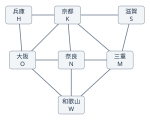

# 第02回の発展　数独の条件と別の題材

条件を増やす、別解を探す、問題を作るという三つの方向へ広げる。数独とは別の題材を試したければ、近畿の三色塗り分けを選べる。[第02回の本文](lesson.md)から独立して始められるよう、各問に条件と出発点を示す。

## 発展1　不等号付き数独 {#inequality}

基本の数独へ、指定された二マスの大小関係を加える。主対角線の条件は使わず、空盤面から始める。数独の重複禁止と、不等号がそれぞれ何を制限するかを比べよう。

::: {.given label="条件と入力"}
4×4盤面の全マスを1〜4とする。行は上から、列は左から1〜4と数え、r行c列の数字を $x_{r,c}$（プログラムでは `grid[r,c]`{.minizinc}）で表す。全相異なりとは、対象の数字がすべて互いに異なることである。初期値はなく、全マスが空欄である。各行・各列と、行1〜2／3〜4・列1〜2／3〜4で区切った四つの2×2ブロックは、それぞれ全相異なりとする。さらに次の三条件を満たす盤面を一つ求める。

$$x_{1,1}<x_{1,2},\qquad x_{2,2}>x_{3,2},\qquad x_{3,3}>x_{3,4}.$$
:::

[inequality-start.mzn](../../../workbook/sessions/02-minizinc/inequality-start.mzn)には基本モデルが入っている。[empty.dzn](../../../workbook/sessions/02-minizinc/empty.dzn)を入力にし、`TODO(作業1)` に三つの不等号を書く。例えば `(2,2)` と `(3,2)` は、同じ列にある上下のマスである。

出力が得られたら三つの比較を別々に確かめる。次は成立する一例で、これ以外の盤面でも条件を満たせばよい。すべての解を列挙する作業は必須にしない。

```text
1 2 3 4
3 4 1 2
2 1 4 3
4 3 2 1
```

この例では、三つの比較が順に1<2、4>1、4>3となる。基本条件も照合できたら、入力を[practice.dzn](../../../workbook/sessions/02-minizinc/practice.dzn)へ交換し、0以外の初期値を保持する条件も使う。この入力は次の盤面で、0は空欄である。

```text
4 3 0 0
2 0 0 3
0 0 1 0
0 0 0 4
```

今度は解なしになる。初期値から決まる盤面のどの比較が合わないか説明しよう。

::: {.hint summary="ヒントを開く：不等号の向き"}
`grid[r,c]`{.minizinc} がr行c列のマスを表す。左側のマス、比較記号、右側のマスを一組として書く。第一条件の `<`{.minizinc} と、後の二条件の `>`{.minizinc} の向きを揃えてしまわないようにする。
:::

## 発展2　既知の解の除外 {#second}

4×4数独の完成盤面を一つ知っているとする。それをもう一度答えとして出すのではなく、条件を満たす別の完成盤面を探したい。既知の盤面だけを除外する条件を書き、別解がある場合とない場合を確かめよう。

### 問題と入力

::: {.given label="条件と入力"}
まずは全16マスが空欄の盤面から始め、次のルールで数字を入れる。行は上から、列は左から、それぞれ1〜4と数える。

- 各マスに入れる数字は1〜4。
- 各行と各列には、それぞれ1〜4を一度ずつ入れる。
- 四つの2×2ブロックにも、それぞれ1〜4を一度ずつ入れる。各ブロックは、行1〜2または行3〜4と、列1〜2または列3〜4を組み合わせた領域である。
- 主対角線の重複禁止や、マス同士の大小関係は条件に加えない。

次の盤面は、このルールを満たす既知の解である。これと**少なくとも一マスで数字が異なる完成盤面を一つ**求める。同じ数字のままのマスがあってもよい。違いは同じ位置のマス同士、つまり行も列も同じマスで比べる。

$$
\begin{array}{cc|cc}
1&2&3&4\\
3&4&1&2\\\hline
2&1&4&3\\
4&3&2&1
\end{array}
$$

この既知の盤面は比較するための入力であり、その16個の数字に答えを固定するものではない。
:::

### 出発ファイルと作業

次の三ファイルを組み合わせて使う。モデルと初期配置に加え、比較用の完成盤面を別の入力として渡す。

| ファイル | 入っているもの |
|---|---|
| [second-start.mzn](../../../workbook/sessions/02-minizinc/second-start.mzn) | 数独の変数・条件・表示と、比較用の入力の宣言。既知の解を除外する条件は未記入 |
| [empty.dzn](../../../workbook/sessions/02-minizinc/empty.dzn) | 全16マスが空欄という初期配置。`given` の全要素が0 |
| [first.dzn](../../../workbook/sessions/02-minizinc/first.dzn) | 問題に示した既知の完成盤面。`first` に与える比較用の数字 |

`given[r,c]`{.minizinc} はr行c列の初期値で、0は空欄を表す。`grid[r,c]`{.minizinc} はそのマスに入れる数字を求める決定変数、`first[r,c]`{.minizinc} は同じ位置にある既知の解の数字である。出発モデルには、値を1〜4にする宣言、行・列・ブロックの条件、0以外の初期値を保持する条件がすでに入っている。

`second-start.mzn` の `TODO(作業1)` に、既知の盤面と少なくとも一マスが異なるという条件を書く。`given`・`grid`・`first` のうち、どの二つを比べるか、その違いをどのマスで要求するかを考えよう。

記述には `exists`{.minizinc} を使える。これは「指定した対象の中に、括弧内の条件を満たすものが少なくとも一つある」を表す。例えば、四要素の配列a・bについて `exists(i in 1..4)(a[i] != b[i])`{.minizinc} は、同じ位置で比べた値が少なくとも一要素で異なるという条件になる。`!=`{.minizinc} は不一致を表す。今回の盤面は二次元なので、行と列の組を対象にする。

保存したモデルに `empty.dzn` と `first.dzn` の両方を指定し、Gecodeで実行する。ファイルの指定や実行操作に迷ったら[実行の手引き](guides/minizinc-start.md)を利用できる。

### 自分の答えの確認

出力の各行・各列・四ブロックに1〜4が一度ずつ現れるかを確かめ、問題に示した既知の盤面と違うマスを一つ指し示そう。完成盤面は複数あり、条件を満たせばどれでもよい。

次に、別解がない場合を調べる。比較用の `first.dzn` はそのままにして、初期配置の `empty.dzn` だけを次の[demo.dzn](../../../workbook/sessions/02-minizinc/demo.dzn)へ交換する。

::: {.given label="確認用の入力"}
0は空欄で、0以外の数字を保持する。行・列・ブロックのルールは、この問題に示したものを使う。

$$
\begin{array}{cc|cc}
1&0&0&4\\
0&4&0&2\\\hline
2&0&4&0\\
0&3&0&1
\end{array}
$$
:::

まず、問題に示した既知の完成盤面が、この初期値と行・列・ブロックの条件をすべて満たすことを確認する。続いて、除外条件を書いたモデルを `demo.dzn` と `first.dzn` で実行する。結果は `UNSATISFIABLE`（解なし）となる。元の条件を満たす解が一つあることと、その解を除くと別の解がないことを合わせて、この初期配置の解は一意だと判断できる。エラーや探索未完了の `UNKNOWN` は、別解なしを示すものではない。

追加条件の意味も読み直そう。`forall` は「指定した対象のすべてで成り立つ」を表す。これで全マスを異ならせると、既知の解と同じ数字を一部に残した別解まで除いてしまう。全解を数えて調べたい場合、初期配置が全空欄の数独には完成盤面が288個あり、正しい除外条件では指定の1個だけが減って287個になる。[全解の確認方法](guides/minizinc-start.md#全解と一意性)は任意の追加確認に利用できる。

::: {.hint summary="ヒントを開く：一マス以上の違い"}
`exists(r in 1..4, c in 1..4)(...)`{.minizinc} の括弧内へ、同じ位置の二つの値が異なる式を書く。`first` を `given` に置き換えると、比較する対象が初期値になってしまう。
:::

## 発展3　手掛かりの削減 {#clues}

完成盤面の数字をいくつ残せば、その盤面に一意に決まるだろう。「一意」とは、初期値と数独の条件に合う完成盤面がちょうど一つだけ存在することである。発展2を終えていなくても、基本モデルの全解を表示する方法で、別解の有無を確認できる。

::: {.given label="設計するもの"}
目標の完成盤面は次のとおり。行は上から、列は左から1〜4と数える。この16個の数字の一部を残し、残りを0（空欄）にした初期配置を作る。

$$
\begin{array}{cc|cc}
1&2&3&4\\
3&4&1&2\\\hline
2&1&4&3\\
4&3&2&1
\end{array}
$$

解の条件は、全マスが1〜4、0以外の初期値を保持、各行・各列・四つの2×2ブロックの数字が、それぞれすべて互いに異なること。ブロックは行1〜2／3〜4と列1〜2／3〜4で区切る。主対角線や不等号は使わない。解がこの盤面だけになる初期配置で、残す数字をできるだけ減らす。
:::

[sudoku4.mzn](../../../workbook/sessions/02-minizinc/sudoku4.mzn)と、完成盤面を初期値にした[complete.dzn](../../../workbook/sessions/02-minizinc/complete.dzn)から始める。モデル中の `given[r,c]`{.minizinc} はr行c列の初期値、`grid[r,c]`{.minizinc} はその位置の解の数字を表す。入力の `given` の値を編集し、モデルの条件はそのまま使う。

入力を `candidate.dzn` という名前で保存し、一つの数字を0へ変える。基本モデルを全解表示で実行し、解が一つのままなら削除を採用し、別解があれば元に戻す。

```sh
minizinc --solver gecode --all-solutions sudoku4.mzn candidate.dzn
```

一解だけを求める通常の実行では、一意性を判断できない。全解の探索が完了し、完成盤面が一つだけ表示されたことを確認する。途中停止・時間切れを「別解なし」と読まない。操作の詳細は[全解と一意性](guides/minizinc-start.md#全解と一意性)にある。

確認用の[minimal.dzn](../../../workbook/sessions/02-minizinc/minimal.dzn)は、(1,1)=1、(2,4)=2、(3,3)=4、(4,2)=3の四つだけを残した入力で、一意に決まる。最後の(4,2)=3を消した[check-G2.dzn](../../../workbook/sessions/02-minizinc/check-G2.dzn)では3解になり、うち2個が目標とは異なる盤面になる。

一つずつ試す手順で「これ以上どれか一つを消すと一意でなくなる」配置ができても、別の位置の組ならもっと少なくできるかもしれない。そこで、削除順を変えて結果を比べる、同じ個数の別配置を調べる、より少ない個数では不可能な根拠を探す、のどれかへ進もう。

::: {.hint summary="ヒントを開く：最小性の調べ方"}
この4×4基本問題の完成盤面は全288個である。例えば三つの位置を固定して、各完成盤面がその三位置に持つ数字の組で分類する。同じ組に二盤面以上が対応するなら、その手掛かりでは一意にならない。この確認をすべての位置の選び方へ広げると、下限を調べられる。
:::

## 選択M02　近畿の三色塗り分け {#kinki}

選択M02では、変数を数独のマスから地域へ置き換える。目安は10〜15分で、他の発展と選んで取り組む。図の地理的な位置ではなく、線で結んだ地域の組を条件にする。

::: {.given label="地域と隣接"}
地域は京都K・大阪O・兵庫H・滋賀S・奈良N・和歌山W・三重M。各地域に1・2・3のいずれかの色を割り当て、次の12辺の両端は異なる色にする。隣接しない地域には同じ色を使ってよい。色名の入替えは異なる割当として数える。

`K-H, K-O, K-N, K-S, K-M,`  
`H-O, O-N, O-W, S-M, N-W, N-M, W-M`
:::



本問の正式な入力は辺の一覧である。[kinki-start.mzn](../../../workbook/sessions/02-minizinc/kinki-start.mzn)には色数 `int: nc = 3;`{.minizinc} と表示部分が入っている。作業1で地域ごとに `var 1..nc`{.minizinc} の変数を宣言し、作業2で辺ごとに `!=`{.minizinc} の条件を書く。例えばAとBが隣接する場合の形は `constraint A != B;`{.minizinc} となる。

出力の順序は `(K,O,H,S,N,W,M)` で、`(1,2,3,3,3,1,2)` は正しい一例である。全12辺を照合しよう。全体を `alldifferent` にすると、隣接しない地域にも別の色を要求してしまう。

次に色数を2へ変えると、解なしになる。K・O・Nの三地域だけを見て、その理由を説明しよう。また、正しい例のHを1へ変えると、K-Hの条件だけを破る。自分のモデルにこの辺があるかも確認できる。

比較としてオーストラリアを試す場合は、[australia-start.mzn](../../../workbook/sessions/02-minizinc/australia-start.mzn)から新しく始める。地域名と辺は次の入力へ丸ごと交換する。同じ色数と「辺の両端を異ならせる」規則を用いる。

::: {.given label="比較の入力"}
地域は `(WA,NT,SA,Q,NSW,V,T)`、色は各地域1〜3。辺は次の9本である。Tには辺がないが、Tにも1〜3の色を割り当てる。

`WA-NT, WA-SA, NT-SA, NT-Q, SA-Q,`  
`SA-NSW, SA-V, Q-NSW, NSW-V`
:::

`(1,2,3,1,2,1,1)` が成立する例である。Tだけを2や3へ変えても条件を満たす。色を区別して全解を数えると近畿は6解、豪州は18解で、どちらも2色では解なしになる。全列挙は比較を深めたい場合だけ行えばよい。

::: {.hint summary="ヒントを開く：辺ごとの条件"}
一地域につき一変数でよい。図の線を一つ選び、その両端の変数を `!=`{.minizinc} で結ぶ。先に全地域の変数を宣言してから、辺の一覧へ印を付けながら条件を書くと、同じ辺の重複や欠落を見つけやすい。
:::

オーストラリアの題材は[MiniZinc Handbookの配色例](https://docs.minizinc.dev/en/stable/modelling.html#our-first-example)でも扱われている。ここでは数独との共通点を、変数・定義域・制約の三つで説明してみよう。
