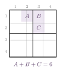
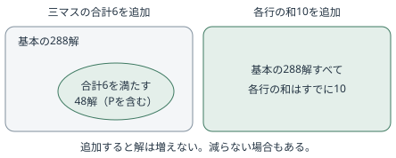

# 第04回　ルールを制約にして、パズルを作る

4×4数独に「この三マスの合計はいくつ」というヒントを加える。与えられたルールを式に写すところから始め、残したい完成盤面と除きたい完成盤面を見比べて、ヒントの対象を自分で選ぶ。

## 目標 {.unnumbered}

今回は、書いた式を実行するだけでなく、その式が何を通し、何を除くかを確かめる。問題文・添字・出力を対応させ、次の三つを説明できるようになろう。

- 対象のマス・演算・比較を分け、三マスの合計条件を書ける。
- 通るべき盤面と拒否すべき盤面を使って、条件の過不足を調べられる。
- 二つの完成盤面を区別する合計ヒントを選べる。

第02回の配列・入力・決定変数を使う。基本条件が完成した[数独モデル](../../../workbook/sessions/04-rules/sudoku4.mzn)と、各演習の出発ファイルを再配布するので、前の演習や発展の完成は不要である。第03回で見た「解なし」と「まだ決まらない」の違いも振り返る。操作は[実行と確認の手引き](guides/puzzle-check.md)で授業内に確認できる。

説明・実演に50分、[5. 演習](#演習)に45分、振り返りに5分を使う。必修1は15分、必修2は25分、残りは確認の目安である。通常演習の提出・宿題・完了報告はなく、教員の完了承認も待たない。発展は関心と進度に合わせて選ぶ。

## 問題

基本の数独には複数の完成盤面がある。ここへ数字を直接書き込む代わりに、一部のマスの合計を知らせる。まず、ヒントが指定する位置と、そこで満たす条件を分けて確認しよう。

::: {.given label="条件と入力"}
初期値のない4×4数独について、次の条件を満たす完成盤面を一つ求める。

- 各マスに1〜4を入れる。各行・各列・四つの2×2ブロックでは、1〜4が一度ずつ現れる。
- ブロックは行1〜2／3〜4と列1〜2／3〜4を組み合わせた四領域とする。
- 三マス $(1,2),(1,3),(2,3)$ の合計は6とする。位置は上からの行番号、左からの列番号で表す。
- 三マスの数字に、基本条件以外の重複禁止は課さない。
:::

合計の対象は次の図のA・B・Cである。色は「足す対象」を表し、同じ色のマスを必ず異なる数字にするという新しいルールは表さない。基本の行・列・ブロックの条件は、そのまま残る。



## 定式化

数独の16個の決定変数は変えずに、一つの等式を加える。新しいルールを加えるたびに基本条件を書き直すのではなく、どの条件を残し、どの条件を追加するかを意識しよう。

### 入力と未知の値

マスの値を $x_{r,c}$ とする。$r,c$ は1〜4の行・列番号であり、$x_{r,c}$ の定義域も1〜4である。入力 $g_{r,c}$ の0は空欄、1〜4は固定する初期値を表す。

指定合計 $t$ は問題として与える入力である。今回の解説例では $t=6$。合計値そのものを自由な未知数にすると、どんな完成盤面でも、その三マスを足した値を選べてしまう。盤面を絞るヒントにするには、先に指定された数と比べる必要がある。

| 役割 | MiniZincの名前 | 今回の指定 |
|---|---|---|
| 初期値の入力 | `given[r,c]`{.minizinc} | 空盤面ならすべて0 |
| 指定合計の入力 | `clue_total`{.minizinc} | 解説例では6 |
| 決定変数 | `grid[r,c]`{.minizinc} | 各マス1〜4 |

### 三項の和と等式

対象の位置を固定し、その位置の値を足してから指定合計と等しいことを課す。数式では次の一行になる。添字の数字そのものを足す式とは区別しよう。

$$x_{1,2}+x_{1,3}+x_{2,3}=t.$$

式は、対象が三マス、演算が足し算、比較が等号、という三部分からなる。対象を変えれば別のルールになり、`=`{.minizinc} を「以下」に変えても別のルールになる。実行できる構文であっても、問題の意味が同じとは限らない。

基本条件から、各行・各列・四つのブロックの全相異なりと、初期値のあるマスの固定を引き継ぐ。合計対象の三マスに対する全相異なりは新設しない。後の必修1では、同じ数字を含む三マスが正しい合計を満たす。

## 解説例

ここは教員が、基本モデルへ合計条件を加えて実演する。ファイル内の手順1〜3と対応させて読み、未知の盤面を求める実行と、完成盤面を固定して検査する実行を使い分ける。

### 手順1　基本条件の再開

[sum-demo.mzn](../../../workbook/sessions/04-rules/sum-demo.mzn)を開く。基本の数独に、指定合計の宣言と一つの追加制約を加えた完成例である。`given`・`grid` と行・列・ブロックの条件は、第02回で読んだものと同じ意味を持つ。

```{.minizinc filename="sum-demo.mzn"}
int: clue_total;
```

`int`{.minizinc} だけなので、この値は実行時に与える。[demo.dzn](../../../workbook/sessions/04-rules/demo.dzn)には、すべて0の `given` と `clue_total = 6;`{.minizinc} がある。対角線や不等号など、前の発展で加えた条件はこのモデルには含まれない。

### 手順2　合計条件の追加

MiniZincの `sum` は、渡した配列の要素を足した値を表す。三つのマスを角括弧で並べてから、その合計が入力と等しいことを `constraint`{.minizinc} で指定する。

```{.minizinc filename="sum-demo.mzn"}
constraint sum([grid[1,2], grid[1,3], grid[2,3]]) = clue_total;
```

これは `grid[1,2] + grid[1,3] + grid[2,3] = clue_total`{.minizinc} と同じ等式である。`sum` だけでは条件ではなく数値の式なので、何とどう比較するかまで書く。今回は指定された三マスをそのまま列挙すればよい。

### 手順3　入力の交換

モデルと `demo.dzn` を組み合わせ、Gecodeで実行する。ファイルを分けずに試す場合は、完成した[一ファイル版](../../../workbook/sessions/04-rules/sum-demo-inline.mzn)を使える。どちらも同じ問題を解く。

```sh
minizinc --solver gecode sum-demo.mzn demo.dzn
```

出力された盤面の行・列・ブロックを確認し、対象の三マスを自分でも足す。続いて、[Pを固定する入力](../../../workbook/sessions/04-rules/P-demo.dzn)へ交換する。この解説例の入力ファイルは一度に一つを指定し、空盤面のデータへ固定盤面のデータを重ねて定義しない。発展2では、異なる入力名を与える二ファイルを併用する場合がある。

Pの16マスを固定した場合、ソルバーが別の盤面へ逃げることはできない。その盤面が条件を満たすかを調べる検査になる。入力だけを交換することで、モデルの同じ追加制約を確かめられる。

## 結果

一つの解が出たときに分かるのは、その出力がモデルの条件を満たしたことだ。モデルが問題文と同じ意味かを調べるには、通る例だけでなく、拒否するべき例も比較する必要がある。

### 固定盤面による確認

次は解説例を満たす完成盤面Pである。空盤面を解いたときの出力がPと違っていても、基本条件と三マスの合計を満たせば正しい。解の出る順序は指定していない。

$$P=\begin{array}{cc|cc}1&2&3&4\\3&4&1&2\\\hline2&1&4&3\\4&3&2&1\end{array}.$$

Pでは対象の値が2・3・1なので、合計は6になる。同じPを固定したまま、指定合計だけを変えると、等号の両側が一致するかを確かめられる。

| 固定盤面 | 指定合計 | 正しい結果 | 見分ける誤り |
|---|---:|---|---|
| P | 6 | Pを受理 | 条件の追加し過ぎ |
| P | 5 | 解なし | `>=`{.minizinc} にしている |
| P | 7 | 解なし | `<=`{.minizinc} にしている |

[合計5の入力](../../../workbook/sessions/04-rules/P-demo-low.dzn)・[合計7の入力](../../../workbook/sessions/04-rules/P-demo-high.dzn)を使う。例えば `<=`{.minizinc} では、合計6のPを指定合計7でも通してしまう。両側の誤りを分けるため、5と7をそれぞれ試す。

これらの確認を通過しても、すべての入力で正しいという証明にはならない。対象の位置が誤っていても、たまたま同じ合計になる盤面はある。式の添字を問題文と照合することと、実行による検査の両方を使おう。

### 解集合と冗長な条件

基本の数独を満たす盤面すべてを集めたものが解集合である。初期値のない4×4数独は288解で、解説例の合計条件を加えると48解になる。一つの合計ヒントでは、Pだけには決まらない。



基本条件を保ったまま追加条件を課すと、残る解は元の解集合の一部になる。もともと違反していた盤面が、新しい条件の追加によって正しい解に変わることはない。

ただし、追加すると必ず解が減るわけではない。基本数独の各行は1〜4を一度ずつ使うので、すでに合計が10である。「各行の和は10」を足しても、288解すべてが残る。このように、他の条件からすでに成り立つ条件を**冗長な制約**と呼ぶ。

冗長かどうかは、残る解の集合についての性質である。処理が必ず速くなるという意味ではない。また、行和10だけで行の全相異なりを置き換えることもできない。和が10でも1・1・4・4のような重複はあり得るからである。[演習](#演習)では、条件を残したまま合計の対象を変える。

## 演習

まず指定された三マスの合計を書き、次に自分で三マスを選ぶ。どちらも基本条件が完成した別々の出発ファイルを使う。前の合計条件を残したまま書き足さないよう、対象の位置を確認してから始めよう。

### 必修1　別の三マスの合計

解説例と同じ書き方で、対象だけを別の三マスに変える。入力の合計値を交換して検査するところまで行い、意図したルールとコードが対応しているかを確かめよう。

#### 問題

::: {.given label="条件と入力"}
4×4の各マスに1〜4を入れ、各行・各列・四つの2×2ブロックで1〜4を一度ずつ使う。ブロックは行1〜2／3〜4と列1〜2／3〜4を組み合わせた四領域。初期値がある場合は保持する。

追加する条件は、$(2,2),(3,2),(3,3)$ の合計9だけとする。解説例の合計条件は引き継がず、この三マスへの追加の重複禁止も課さない。まず初期値なしで解く。

検査用の完成盤面は次のPを使う。

$$P=\begin{array}{cc|cc}1&2&3&4\\3&4&1&2\\\hline2&1&4&3\\4&3&2&1\end{array}.$$
:::

#### 作業

位置 `(r,c)` は上からr行目・左からc列目で、行・列は1〜4とする。`grid[r,c]`{.minizinc} はそのマスの解の数字、`given[r,c]`{.minizinc} は初期値（0なら空欄）、`clue_total`{.minizinc} は指定合計を表す。

[sum-start.mzn](../../../workbook/sessions/04-rules/sum-start.mzn)を自分の作業用に保存する。基本条件・入力宣言・出力は用意してある。追加するのは一つの等式であり、`grid` の値をPに直接固定する制約ではない。

```{.minizinc filename="sum-start.mzn"}
% TODO(作業1): 指定された三マスを選び、合計の等式を書く。
% TODO(作業2): P固定と合計8・10の入力で受理・拒否を確かめる。
```

1. **作業1：** `sum` は配列に並べた値を足す。対象の三マスをその配列へ並べ、`clue_total`{.minizinc} と等しい制約を書く。初期値は全マス0、指定合計は9の[practice.dzn](../../../workbook/sessions/04-rules/practice.dzn)で実行し、出力の合計を確かめる。
2. **作業2：** [P・合計9](../../../workbook/sessions/04-rules/P-practice.dzn)、[P・合計8](../../../workbook/sessions/04-rules/P-practice-low.dzn)、[P・合計10](../../../workbook/sessions/04-rules/P-practice-high.dzn)へ一つずつ交換する。いずれも `given` の全16マスに問題のPを入れ、`clue_total`{.minizinc} だけを9・8・10へ変えた入力である。モデルは変えず、受理する場合と解なしになる場合を記録する。

#### 自己確認

Pの対象値は4・1・4で、合計は9になる。P固定では9を受理し、8と10を拒否できればよい。二つの4は異なる行・列・基本ブロックにあるため、この問題の重複禁止には違反しない。

空盤面では複数の答えがあり、全列挙すると60解になる。個数の列挙は操作に余裕がある場合の確認でよい。まず一つの出力を足し、Pを固定する三つの検査と式の添字を確かめる。[確認手引き](guides/puzzle-check.md)には対象値の合計がずれた別の完成盤面もある。

::: {.hint summary="ヒントを開く：二つの4と対象の範囲"}
対象位置をPの上で一つずつ指す。`grid[2,2]`{.minizinc} の4と `grid[3,3]`{.minizinc} の4は、同じ行にも列にも基本ブロックにもいない。`sum` の対象であることを理由に `alldifferent` を加えると、通るべきPを拒否してしまう。
:::

### 必修2　二つの盤面を区別するヒント

ここでは、式の対象となる位置を自分で決める。PとQの値を比較し、三マスを足したときに差が残る選び方を探そう。ルールの種類は合計の等式一つに固定する。

#### 問題

::: {.given label="条件と入力"}
4×4の各マスに1〜4を入れる。各行・各列・四つの2×2ブロックで1〜4を一度ずつ使い、初期値があれば保持する。ブロックは行1〜2／3〜4と列1〜2／3〜4の組合せとする。

異なる三マスを選び、その合計を指定するヒントを一つ作る。三マスは隣接しなくてもよく、同じ数字を含んでもよい。下のPを受理し、Qを拒否することを求める。

$$P=\begin{array}{cc|cc}1&2&3&4\\3&4&1&2\\\hline2&1&4&3\\4&3&2&1\end{array},\qquad
Q=\begin{array}{cc|cc}1&2&3&4\\3&4&2&1\\\hline2&1&4&3\\4&3&1&2\end{array}.$$

基本条件以外に加えてよいのは、この三マスの合計条件だけ。解説例・必修1の合計条件は引き継がない。Pへの直接固定では代替できない。Pが唯一の解になることは要求しない。
:::

#### 作業

位置 `(r,c)` は上からr行目・左からc列目で、行・列は1〜4とする。`grid[r,c]`{.minizinc} はそのマスの解の数字、`given[r,c]`{.minizinc} は初期値（0なら空欄）、`clue_total`{.minizinc} は指定合計を表す。

[design-start.mzn](../../../workbook/sessions/04-rules/design-start.mzn)を使う。三マスを決めたらPでの合計を入力の値としてモデル内へ書く。ここでは固定した合計を使って、P・Q・空盤面の入力を交換する。

```{.minizinc filename="design-start.mzn"}
int: clue_total = 0; % TODO(作業1): 異なる三マスを選び、Pでの合計に変更する。
% TODO(作業2): 選んだ三マスの合計制約を一つ書く。
```

1. **作業1：** 三つの位置、Pの三つの値と合計、Qの三つの値と合計をメモする。合計が等しければ位置を選び直し、`clue_total`{.minizinc} の0をPの合計へ変更する。
2. **作業2：** 選んだ三マスの合計を `clue_total`{.minizinc} と等しくする。[P.dzn](../../../workbook/sessions/04-rules/P.dzn)・[Q.dzn](../../../workbook/sessions/04-rules/Q.dzn)・[empty.dzn](../../../workbook/sessions/04-rules/empty.dzn)を別々に指定して実行する。P・Qの入力は `given` の全16マスをそれぞれの完成盤面に固定し、空盤面の入力は全マスを0にする。

#### 自己確認

P固定では受理、Q固定では解なし、空盤面では少なくとも一解が出ることを確かめる。解なしは `UNSATISFIABLE` で確認し、エラーや時間切れとは区別する。三つの位置は本当に異なるか、合計以外の条件でQを拒否していないかも、コードを読み返して確認する。

PとQで値が異なるマスを含めても、別のマスで差が打ち消されることがある。異なるマスを見つけるだけで終えず、三つを足した結果を比較しよう。正しい選び方は複数あり、他の人と同じ三マスである必要はない。

::: {.hint summary="ヒントを開く：差が打ち消されるか調べる"}
選んだ三マスごとにPの値からQの値を引き、その三つの差を足す。合計が0なら区別できない。差のある位置を一つ選び、残り二つをどう選べば差を保てるか考えよう。
:::

::: {.hint summary="ヒントを開く：確認例・合計の差を残す選び方"}
PとQでは2行3列の値が1だけ違う。この位置に、両盤面で値が同じ二マスを組み合わせると差が残る。例えば3行3列・3行4列を選んだ場合、PとQのそれぞれで三項を実際に足してみよう。
:::

## 発展

合計を複数に広げる、一意性を確かめる、別のパズルへ移すという方向がある。[独立した発展演習](advanced-exercises.md)では、それぞれ必要な条件と出発モデルを用意している。前の発展の完成は不要である。

| 選択 | 深めること |
|---|---|
| [発展1　複数の合計ヒント](advanced-exercises.md#multiple) | ヒントごとに対象位置・合計・有効かどうかを入力にする |
| [発展2　第二解と一意性](advanced-exercises.md#second) | 既知の解を除き、第二解があるかを調べる |
| [発展3　最少の合計ヒント](advanced-exercises.md#minimum) | 36候補から最少のヒントを選び、最小性まで確かめる |
| [選択M04　SEND+MORE=MONEY](advanced-exercises.md#send-more) | SEND+MORE=MONEYを数字の範囲・重複禁止・等式で解く |

次の第05回では、和の対象をマスの値から「選ばれた人数」へ広げる。添字集合全体を足す書き方は、その回の本編で改めて説明する。

## 振り返り

自分の合計条件を、対象・演算・比較に分けて読もう。続いて、Pを通すだけでは足りない理由と、Qを除くために対象をどう選んだかを説明する。実行結果と問題文の対応を言葉にできるかが確認の中心となる。

- 合計の等式を「以下」に変えると、どんな盤面を余分に通すか。
- 条件を加えても解の個数が変わらない例は何か。
- Pを通しQを除いたことから、Pが唯一の解だと言えるか。

## 参照 {.unnumbered}

作業を再開するときは、使うモデルと入力の組を先に確かめる。合計値をモデル内で定義する必修2と、入力ファイルで定義する解説例・必修1では、渡すデータが異なる。

| 用語・操作 | 意味・参照先 |
|---|---|
| `sum([a,b,c])`{.minizinc} | 三つの値を足した数値の式。比較を付けて制約にする |
| 解集合 | モデルの条件をすべて満たす解を集めた集合 |
| 冗長な制約 | 他の条件からすでに成り立ち、追加しても解集合を変えない制約 |
| 解なし | 固定した入力のもとで、全条件を満たす解が存在しない |
| 実行と検査 | [入力の選択・結果の読み方](guides/puzzle-check.md) |
| 配布物 | [一式のZIP](../../../workbook/sessions/04-rules/session-04.zip)、[必修1](../../../workbook/sessions/04-rules/sum-start.mzn)、[必修2](../../../workbook/sessions/04-rules/design-start.mzn) |
| 記法の原典 | [MiniZinc公式教材：配列と集約](https://docs.minizinc.dev/en/stable/modelling2.html) |

位置の取り違え、`=`{.minizinc} と `<=`{.minizinc} の取り違え、合計対象への余分な全相異なりは、どれも実行できる場合がある。[結果の確認](#結果)に戻り、受理例と拒否例に加えて、式の意味も読み直そう。
