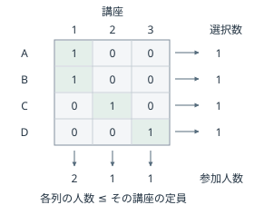

# 第05回　講座の割当を0/1の表で表す

同時に開かれる体験講座へ、一人一つずつ参加先を割り当てる。人と講座を縦横に並べた表を使い、「選ぶかどうか」を0と1で表す。行や列の和から、参加先の数や講座の人数を数えよう。

## 目標 {.unnumbered}

この回では、誰に何を割り当てるかを変数の意味として定め、選び方を制約で表す。完成した表を読んで、次の三つを説明できるようになろう。

- 許可を表す入力と、実際の選択を表す0/1変数を区別できる。
- 行と列を集計し、一人一講座・定員・許可の条件を書ける。
- 開催する場合としない場合の人数の条件を、0/1の開催フラグと結べる。

MiniZincの配列・`forall`・三項の`sum`を使う。添字の範囲全体を足す書き方は、この回で説明する。第04回の発展の完成は不要で、[基本モデル](../../../workbook/sessions/05-assignment/assignment-base.mzn)と各演習の出発ファイルから再開できる。実行操作は[割当の確認手引き](guides/assignment-check.md)を使って授業内で確かめる。

説明・実演に50分、[5. 演習](#演習)に45分、振り返りに5分を使う。必修1は20分、必修2は確認を含め25分を目安とする。所要時間は授業試行で確かめる。通常演習の提出・宿題・完了報告はなく、教員の完了承認も待たない。発展は関心と進度に合わせて選ぶ。

## 問題

参加できる講座が複数あっても、同時開催なので実際に参加するのは一つである。まず、参加可能な組合せを示した入力と、これから決める参加先を分けて読もう。

::: {.given label="条件と入力"}
4人A〜Dを、講座1〜3へ一人ちょうど一つずつ割り当てる。各講座の人数は定員以下とし、空席を残してもよい。許可表が1の組合せだけを選び、0の組合せは選ばない。

| 人 | 講座1 | 講座2 | 講座3 |
|---|---:|---:|---:|
| A | 1 | 1 | 0 |
| B | 1 | 0 | 1 |
| C | 1 | 1 | 1 |
| D | 0 | 1 | 1 |
| 定員 | 2 | 1 | 1 |

求めるのは、これらをすべて満たす割当を一つ。希望の順位や、よりよい割当を選ぶ基準は指定しない。
:::

例えばAは講座1か2へ参加できるが、両方へ参加するのではない。Cはどの講座にも参加できる。許可表の1は「選んでもよい」であり、「必ず選ぶ」ではない。

## 定式化

人と講座の組ごとに、選ぶかどうかを一つの変数で表す。数独では各セルが1〜4の数字だったが、今回は各セルの意味も値の範囲も変わる。表の形が似ていても、同じ制約を移さないようにしよう。

### 許可表と割当表

人の集合を $P=\{1,2,3,4\}$、講座の集合を $C=\{1,2,3\}$ とする。人の番号1〜4はA〜Dに対応する。入力 $a_{p,c}$ は許可、$\mathrm{cap}_c$ は講座cの定員を表す。

決定変数 $x_{p,c}\in\{0,1\}$ を置き、1なら人pを講座cへ割り当て、0なら割り当てないと定義する。数独の入力で使った「0は空欄」という意味とは異なり、今回は0も完成した答えの値である。

| 対象 | 意味 | MiniZincの名前 |
|---|---|---|
| 入力 $a_{p,c}$ | 許可なら1、禁止なら0 | `allowed[p,c]`{.minizinc} |
| 入力 $\mathrm{cap}_c$ | 非負整数の定員 | `cap[c]`{.minizinc} |
| 決定変数 $x_{p,c}$ | 選ぶなら1、選ばないなら0 | `x[p,c]`{.minizinc} |

### 行の和と列の和

0と1を足すと、1の個数が得られる。一人を固定して講座について足すと、その人が選んだ講座数になる。講座を固定して人について足すと、その講座の参加人数になる。

$$\sum_{c\in C}x_{p,c}=1\quad(p\in P),\qquad
\sum_{p\in P}x_{p,c}\le\mathrm{cap}_c\quad(c\in C).$$

左は一人ちょうど一講座なので等号、右は高々定員なので不等号である。左を「1以下」にすると、どこにも参加しない行も許してしまう。右を等号にすると、必要のない満席条件を加えることになる。



図はA〜Dが順に講座1・1・2・3を選んだ表である。横には講座の方向、縦には人の方向へ足している。集計する前に、どちらの添字を固定し、どちらを動かすかを言葉にすると式を読みやすい。

### 許可と選択の関係

許可が0のセルでは選択も0にし、許可が1なら選択は0でも1でもよい。変数の範囲が0/1であることを使うと、この関係を次の不等式で表せる。

$$x_{p,c}\le a_{p,c}\quad(p\in P,\ c\in C).$$

$a_{p,c}=0$ のときは $x_{p,c}\le0$ なので0だけが残る。$a_{p,c}=1$ なら $x_{p,c}\le1$ で、0と1の両方を許す。実際にどの許可セルを選ぶかは、一人一講座と定員の条件も合わせて決まる。

## 解説例

ここでは教員が、入力・変数・三種類の条件を順に実装する。基本モデルの手順1〜3のコメントと対応させて読む。数式で数えたものが、コードでも同じ対象になっているかを確認しよう。

### 手順1　選択の変数

[assignment-base.mzn](../../../workbook/sessions/05-assignment/assignment-base.mzn)を開く。人数と講座数を入力にし、それぞれの番号の範囲へ名前を付けている。人数を変えたときに、モデル内の足し算を一つずつ増やさずに済む。

```{.minizinc filename="assignment-base.mzn"}
int: n_people;
int: n_courses;
set of int: PEOPLE = 1..n_people;
set of int: COURSES = 1..n_courses;
array[PEOPLE, COURSES] of 0..1: allowed;
array[COURSES] of int: cap;
array[PEOPLE, COURSES] of var 0..1: x;
```

`PEOPLE`と`COURSES`は添字の集合であり、未知の参加先ではない。`allowed`には`var`{.minizinc}がなく入力、`x`には`var`{.minizinc}があり決定変数である。許可表の値を、そのまま割当表へ代入するわけではない。

[base.dzn](../../../workbook/sessions/05-assignment/base.dzn)に4人分の許可表と定員が入っている。配列の第1添字が人、第2添字が講座で、入力の行の並びはA・B・C・D。モデルと入力でこの対応を揃える。

### 手順2　一人一講座

まず人Aだけを考える。その行の三つを足す式は `sum([x[1,1], x[1,2], x[1,3]])`{.minizinc} である。講座数に合わせて並べる部分を、添字の範囲を使った形に書き換える。

```minizinc
sum(c in COURSES)(x[1,c])
```

この式は、`c`を`COURSES`の各要素に置き換えた値を足す。`sum`は数を作る集約で、`forall`は条件をすべて満たすことを表す。両者を組み合わせ、各人で一つの等式を課す。

```{.minizinc filename="assignment-base.mzn"}
constraint forall(p in PEOPLE)(sum(c in COURSES)(x[p,c]) = 1);
```

外側の`forall`で一人pを選び、内側の`sum`でその人の講座cを動かす。数式の「各人について行和が1」をそのまま表している。表全体の和を人数にするだけでは、二つ選ぶ人と一つも選ばない人が混ざる場合を除けない。

### 手順3　定員と許可

講座の参加人数を数えるときは、人と講座の役割が入れ替わる。今度は外側で講座cを固定し、内側で人pを動かす。最後に、すべてのセルで選択と許可の関係を課す。

```{.minizinc filename="assignment-base.mzn"}
constraint forall(c in COURSES)(sum(p in PEOPLE)(x[p,c]) <= cap[c]);
constraint forall(p in PEOPLE, c in COURSES)(x[p,c] <= allowed[p,c]);
```

これで三種類の条件が揃った。`solve satisfy;`{.minizinc}で条件を満たす割当を求める。モデルと`base.dzn`を組み合わせ、Gecodeで実行しよう。環境操作は[確認手引き](guides/assignment-check.md)にまとめてある。

```sh
minizinc --solver gecode assignment-base.mzn base.dzn
```

## 結果

出力の各行は人、各列は講座で、1が参加先を示す。まずその表を人の参加先へ読み替え、行の選択数・列の人数・禁止位置を別々に確認しよう。出力例と同じ並びかどうかだけでは判断しない。

### 三種類の確認

次は条件を満たす出力の一例である。上からA・B・C・Dの行で、AとBが講座1、Cが講座2、Dが講座3へ参加する。どの人も一つだけ選んでいる。

```text
1 0 0
1 0 0
0 1 0
0 0 1
```

| 調べる条件 | この表の確認 |
|---|---|
| 一人一講座 | 各行の和はすべて1 |
| 定員以下 | 列の和は2・1・1で、定員2・1・1以下 |
| 許可 | 1を置いたセルは、許可表でもすべて1 |

この入力の解は4通りあり、最初に出る表の順序は指定していない。別の表でも三条件を満たせば正しい。必要なら[全解の確認](guides/assignment-check.md#全解と終了状態)で数を調べられるが、必修では各条件との照合を中心にする。

次に[roomy.dzn](../../../workbook/sessions/05-assignment/roomy.dzn)へ交換する。許可表は同じで、定員が3・2・1になる。上の割当は人数2・1・1のままで正しく、講座1と2には空席が残る。定員を等号で書くと、この正しい割当まで拒否してしまう。[演習](#演習)でも「上限」と「ちょうど」を使い分けよう。

### 一人一変数との対応

一人の行には1がちょうど一つあるので、その位置の講座番号だけを保存する表現も考えられる。例えば上の割当は、A〜Dの講座番号を並べた1・1・2・3に対応する。

| 人 | 0/1表の一行 | 講座番号を一つの値で表す場合 |
|---|---|---:|
| A | 1, 0, 0 | 1 |
| B | 1, 0, 0 | 1 |
| C | 0, 1, 0 | 2 |
| D | 0, 0, 1 | 3 |

講座番号を $y_p$ とすると、$x_{p,c}=1$ と $y_p=c$ が対応する。ただし、一人一変数へ変えた場合は、定員や許可の数え方も変える必要がある。変数の個数だけで解きやすさを決めず、表したい条件との対応を見る。今回は読む比較までにし、別表現の実装は発展1で扱う。

## 演習

まず人数が増えた割当を同じ構造で書き、次に開催する場合としない場合の人数を条件にする。それぞれ出発ファイルを用意している。行・列のどちらを足すかと、等号・不等号の意味を確かめながら進めよう。

### 必修1　五人の講座割当

入力の規模が変わっても、条件の種類は解説例と同じである。人数を固定した足し算ではなく、添字の集合を使って変数と制約を書く。入力を交換しても条件が同じ意味になるか考えよう。

#### 問題

::: {.given label="条件と入力"}
5人A〜Eを講座1〜3へ、一人ちょうど一つずつ割り当てる。許可表が1の組合せだけを選び、0は選ばない。講座の人数は定員以下とし、満席にする必要はない。

| 人 | 講座1 | 講座2 | 講座3 |
|---|---:|---:|---:|
| A | 1 | 1 | 0 |
| B | 1 | 0 | 1 |
| C | 1 | 1 | 1 |
| D | 0 | 1 | 1 |
| E | 1 | 0 | 1 |
| 定員 | 2 | 2 | 1 |

すべての条件を満たす割当を一つ求める。人の番号1〜5はA〜Eに対応する。
:::

#### 作業

表の行は人、列は講座を表す。`x[p,c]`{.minizinc} は人pを講座cへ割り当てるなら1、割り当てないなら0の決定変数である。`allowed[p,c]`{.minizinc} は表の許可、`cap[c]`{.minizinc} は定員の入力。`PEOPLE` は人の番号の集合（この表では1〜5、四人の確認入力では1〜4）、`COURSES` は講座番号1〜3の集合を表す。

[practice-start.mzn](../../../workbook/sessions/05-assignment/practice-start.mzn)には入力宣言・添字の集合・出力を用意した。出力で使う`x`はまだ宣言されていないため、TODOを埋めてから実行する。

```{.minizinc filename="practice-start.mzn"}
% TODO(作業1): 人×講座の0/1決定変数xを宣言する。
% TODO(作業2): 一人一講座・定員・許可の三条件を書く。
```

1. **作業1：** 人と講座を添字に持つ`x`を、0/1の決定変数として宣言する。
2. **作業2：** 各人の行和、各講座の列和、各セルの許可に対応する三種類の制約を書く。[practice.dzn](../../../workbook/sessions/05-assignment/practice.dzn)と組み合わせて実行し、表を条件と照合する。

#### 自己確認

例えばA〜Eが順に講座1・1・2・2・3を選べば成立する。各行に1が一つあり、列の人数は2・2・1になる。出力が違っていても、許可された位置だけを選び三条件を満たせばよい。

[正しい表](../../../workbook/sessions/05-assignment/check-valid.dzn)と[空席のある表](../../../workbook/sessions/05-assignment/check-empty-seat.dzn)は受理し、[二重割当](../../../workbook/sessions/05-assignment/check-double.dzn)・[未割当](../../../workbook/sessions/05-assignment/check-unassigned.dzn)・[定員超過](../../../workbook/sessions/05-assignment/check-capacity.dzn)・[禁止選択](../../../workbook/sessions/05-assignment/check-forbidden.dzn)は拒否する。これらは入力の`x`を固定して検査するデータで、通常の`practice.dzn`へ一つずつ交換して使う。空席の検査は4人・定員3・2・1へ入力全体を交換する。5人版の定員2・2・1では列和を等号にしても同じ解が出るので、この交換で上限の意味を確かめる。`practice.dzn`を全列挙する場合は6解になる。

検査する具体的な割当は次のとおり。各人の順に参加先を記し、—は未割当、{1,2}は二講座への同時割当を表す。4人のケースではA〜Dだけを使い、許可表はこの問題のA〜Dの行と同じである。

| 確認入力 | 人の順に並べた参加先 | 定員（講座1,2,3） |
|---|---|---|
| 正しい表 | 1・1・2・2・3 | 2・2・1 |
| 空席のある表 | 1・1・2・3 | 3・2・1 |
| 二重割当 | {1,2}・1・1・3 | 3・2・1 |
| 未割当 | —・1・2・2・3 | 2・2・1 |
| 定員超過 | 1・1・1・2・3 | 2・2・1 |
| 禁止選択 | 1・1・2・3・2 | 2・2・1 |

::: {.hint summary="ヒントを開く：固定する添字と動かす添字"}
一人の参加先の数は、人pを固定して講座cを動かす。講座の人数は、講座cを固定して人pを動かす。最後に`x[p,c] <= allowed[p,c]`{.minizinc}が、許可0と1のそれぞれで何を許すかを確認する。
:::

### 必修2　開催する講座の選択

人数が少な過ぎる講座は開かないことにする。参加先に加えて開催の有無も決め、開催する場合としない場合で許される人数を分けて考えよう。基本の三条件は完成したモデルから引き継ぐ。

#### 問題

::: {.given label="条件と入力"}
5人A〜Eを講座1〜3へ一人ちょうど一つ割り当てる。許可表が1の組合せだけを選び、定員は各講座3人とする。

| 人 | 講座1 | 講座2 | 講座3 |
|---|---:|---:|---:|
| A | 1 | 1 | 0 |
| B | 1 | 0 | 1 |
| C | 1 | 1 | 1 |
| D | 0 | 1 | 1 |
| E | 1 | 0 | 1 |
| 定員 | 3 | 3 | 3 |

開催する講座は2〜3人、開催しない講座は0人とする。人の番号1〜5はA〜Eに対応する。参加先と開催する講座を求める。開催数の最小化や、AとDを分ける条件は置かない。
:::

#### 作業

表の行は人、列は講座を表す。`x[p,c]`{.minizinc} は人pを講座cへ割り当てるなら1、割り当てないなら0の決定変数である。`allowed[p,c]`{.minizinc} は表の許可、`cap[c]`{.minizinc} は定員の入力。`PEOPLE` は人の番号の集合（1〜5がA〜Eに対応）、`COURSES` は講座番号1〜3の集合を表す。

[open-start.mzn](../../../workbook/sessions/05-assignment/open-start.mzn)と[open.dzn](../../../workbook/sessions/05-assignment/open.dzn)を使う。同じフォルダーの[assignment-base.mzn](../../../workbook/sessions/05-assignment/assignment-base.mzn)には一人一講座・定員・許可が完成しており、必修1の完成は不要。`opened[c]`{.minizinc}は開催なら1、非開催なら0を表す決定変数として用意した。

```{.minizinc filename="open-start.mzn"}
% TODO(作業1): 開催時は2人以上にする。
% TODO(作業2): 非開催時は0人にし、開催時の上限も守る。
```

1. **作業1：** 講座cの人数を数え、開催フラグが0と1の場合に許す人数をそれぞれメモする。その表から人数の下限を表す条件を考える。
2. **作業2：** 人数の上限を開催フラグと結ぶ条件を考え、すべての講座へ適用する。`open.dzn`で解き、人数とフラグを一緒に確認する。

フラグで人数の下限・上限を変えることで、「開催した場合だけ」という条件を表せる。フラグそのものは入力でなく、参加先と整合するようソルバーが決める値である。

#### 自己確認

A〜Eが1・3・1・3・1を選ぶと、人数は3・0・2、開催フラグは1・0・1になり成立する。別の割当でも、各行の選択・許可・定員と、開催の条件を満たせばよい。全列挙する場合は12解だが、列挙は必須ではない。

次の確認入力を通常の`open.dzn`と一つずつ交換して、編集した同じモデルへ渡す。入力は割当表を固定する。後半の二例は開催フラグも固定し、前半の二例ではフラグをモデルに決めさせる。

| 入力 | 固定する参加先（A〜E）とフラグ | 期待する結果 | 確かめる条件 |
|---|---|---|---|
| [開催の正例](../../../workbook/sessions/05-assignment/check-open-valid.dzn) | 1・3・1・3・1。フラグは未固定 | 受理 | 人数3・0・2、開催1・0・1 |
| [1人だけの講座](../../../workbook/sessions/05-assignment/check-open-single.dzn) | 1・1・1・2・3。フラグは未固定 | 拒否 | 開催時の最低人数 |
| [非開催に人がいる](../../../workbook/sessions/05-assignment/check-open-missing.dzn) | 1・3・1・3・1、フラグ0・0・1 | 拒否 | 非開催なら0人 |
| [空なのに開催](../../../workbook/sessions/05-assignment/check-open-empty.dzn) | 1・3・1・3・1、フラグ1・1・1 | 拒否 | 開催フラグと人数の対応 |

後半の二例は割当表だけなら正しい。同じ表でもフラグが違えば拒否する理由を、自分の二つの条件で説明しよう。実行方法は[確認手引き](guides/assignment-check.md)へ。

::: {.hint summary="ヒントを開く：フラグが0と1の場合"}
フラグ0と1の二行の表を作り、それぞれで人数の下限と上限を書き出す。片方のフラグで合うだけでなく、もう片方でも許したい範囲になるかを確かめよう。
:::

::: {.hint summary="ヒントを開く：二つの条件の式"}
```minizinc
constraint forall(c in COURSES)(2*opened[c] <= sum(p in PEOPLE)(x[p,c]));
constraint forall(c in COURSES)(sum(p in PEOPLE)(x[p,c]) <= cap[c]*opened[c]);
```
下限だけなら非開催に人が入る場合を、上限だけなら空なのに開催する場合を除けない。それぞれ対応する拒否入力で確認する。
:::

## 発展

別の変数表現や特定の二人の分離へ広げるほか、割当できない理由を説明する方向にも進める。[独立した発展ページ](advanced-exercises.md)には各問題の入力と出発点があり、前の発展の完成は不要である。

| 選択 | 深めること |
|---|---|
| [発展1　一人一変数の表現](advanced-exercises.md#value) | 一人一変数の表現へ移し、同じ割当集合になるか確かめる |
| [発展2　二人の参加先の分離](advanced-exercises.md#separate) | 特定の二人を異なる講座へ割り当てる |
| [発展3　割当できない理由](advanced-exercises.md#obstruction) | 利用できる定員が足りない人の集合から、不可能性を説明する |
| [選択M05　出現回数を表す数列](advanced-exercises.md#series) | 各数字の出現回数を表す数列を作る |

次の第06回は4人の基本割当へ戻り、各選択に評価値を付ける。完成した出発モデルを再配布するので、5人版や今回の追加条件を自分で戻す必要はない。

## 振り返り

一人を固定した和と、講座を固定した和をそれぞれ指し、何を数えているか説明しよう。コードの添字だけでなく、0と1の意味から条件を読み直すと、別の割当問題にも移しやすくなる。

- 許可表が1でも、その講座を選ばなくてよいのはなぜか。
- 行には等号、列には不等号を使ったのはなぜか。
- 開催フラグと人数を結ぶ二条件は、それぞれどんな誤った組を除くか。

## 参照 {.unnumbered}

作業を再開するときは、モデルと入力の組を確認する。通常の入力は参加先を未知のままにし、確認用入力は`x`も指定するため、特定の表が受理されるかを調べる実行になる。

| 用語・記法 | 意味・参照先 |
|---|---|
| `var 0..1`{.minizinc} | 選ぶかどうかを表す決定変数 |
| `sum(c in COURSES)(x[p,c])`{.minizinc} | 人pを固定した行の和 |
| `sum(p in PEOPLE)(x[p,c])`{.minizinc} | 講座cを固定した列の和 |
| `forall` | 指定範囲のすべてで条件を満たす |
| 配布と実行 | [ファイル一覧と確認手順](guides/assignment-check.md) |
| 記法の原典 | [MiniZinc公式教材：配列と集約](https://docs.minizinc.dev/en/stable/modelling2.html) |

行と列の取り違え、定員を等号にする誤り、許可の1を選択義務にする誤りは、[結果の確認](#結果)へ戻って見分ける。解が出ないときも、入力が不可能なのか、条件を加え過ぎたのかを分けて調べよう。
