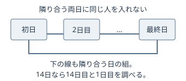

# 第07回の発展　二人の組・二種類の技能・周期勤務

第07回の内容から、関心に合わせて選ぶ三問である。[必修演習](lesson.md#演習)を写し終えていなくても、各問の出発ファイルから始められる。三問は独立していて、どれから始めてもよい。全部を終えることは前提にしない。次の通常回はこの発展を前提にしないので、途中で止めても差し支えない。

出発点はそれぞれ違う。発展1と発展2は技能の条件を含まない必修1のモデルから始め、必修2で加えた技能の条件は引き継がない。発展3は入力も条件も新しく、一人二日までの上限も引き継がない。

## 発展1　同じ日に選べない二人 {#pair}

AさんとBさんは同じ作業の担当が重なると効率が落ちるため、同じ日には入れないことにした。二人とも休む日があってもよい。

五人・四日の[入力](../../../workbook/sessions/07-schedule/practice.dzn)を使う。[発展1の出発モデル](../../../workbook/sessions/07-schedule/pair-start.mzn)には技能なしの基本条件を記入済みである。作業1で同日勤務の禁止を加え、作業2で二人とも休む日を許しているか確認する。

::: {.given label="条件と入力"}
人の集合 $P$ はA〜Eの5人、日の集合 $D$ は日1〜4である。$x_{p,d}$ は人pが日dに勤務するなら1、休むなら0の決定変数、$a_{p,d}$ は勤務できるなら1、できないなら0の入力を表す。$r_d$ は日dの必要人数、$u_p$ は人pの勤務日数の上限である。各日ちょうど2人を勤務可能な人から選び、各人の勤務は合計2日以下とする。

$P=\{1,\ldots,5\}$（A〜E）、$D=\{1,\ldots,4\}$、$r=(2,2,2,2)$、$u=(2,2,2,2,2)$ とし、勤務可能性 $a$ は A=1101、B=1011、C=0111、D=1110、E=1111 とする。

次の五つをすべて満たす行列 $x$ を一つ求めよ。最後の一つが今回加える条件である。

$$x_{p,d}\in\{0,1\},\qquad
\sum_{p\in P}x_{p,d}=r_d,\qquad
x_{p,d}\le a_{p,d},\qquad
\sum_{d\in D}x_{p,d}\le u_p,\qquad
x_{A,d}+x_{B,d}\le1.$$
:::

モデルでは `work[p,d]`{.minizinc} が $x_{p,d}$、`available[p,d]`{.minizinc} が $a_{p,d}$、`required[d]`{.minizinc} が $r_d$、`max_days[p]`{.minizinc} が $u_p$ に対応する。`PEOPLE=1..5`{.minizinc} はA〜E、`DAYS=1..4`{.minizinc} は日1〜4の番号である。

::: point
「同じ日に二人とも入らない」は $x_{A,d}+x_{B,d}\le1$ である。等号にすると「必ずどちらか一人が入る」という別の条件になり、二人とも休む日を禁じてしまう。
:::

::: check
出力で、AとBが同じ日に1になっていないことを確かめる。次の表は日1から順に勤務する二人を並べたもので、どちらも勤務可能性・各日2人・各人2日以下を満たす。

| 各日の担当 | 確認する点 | 期待 |
|---|---|---|
| AB／AD／CD／BC | 日1でAとBが同時に勤務する | 拒否 |
| DE／AC／BD／BC | AとBは同時に勤務せず、日1は二人とも休む | 受理 |

担当者なら `constraint work[p,d] = 1;`{.minizinc}、それ以外なら `constraint work[p,d] = 0;`{.minizinc} を全20マス分モデルへ一時追加し、一方ずつ固定して実行する。表を交換するとき・通常の求解へ戻るときは固定条件を外す。[表をまとめて固定する書き方](guides/roster-check.md#二人の固定検査)も使える。
:::

## 発展2　二種類の技能を確保する {#skills}

技能が二種類ある場合を考える。レジ締めができるのはAとB、発注ができるのはB・C・Dである。Bは両方できる。各日、それぞれの技能を持つ人を少なくとも一人ずつ入れたい。

五人・四日の勤務表に、二種類それぞれの技能人数の条件を加える。[発展2の出発モデル](../../../workbook/sessions/07-schedule/two-skill-start.mzn)に、[基本入力](../../../workbook/sessions/07-schedule/practice.dzn)と[二種類の技能の入力](../../../workbook/sessions/07-schedule/skills.dzn)を組み合わせる。基本条件と技能の入力宣言は記入済みである。作業1で技能別の下限を実装し、作業2でBの数え方と強めた下限を確認する。

::: {.given label="条件と入力"}
人の集合 $P$ はA〜Eの5人、日の集合 $D$ は日1〜4である。$x_{p,d}$ は人pが日dに勤務するなら1、休むなら0の決定変数、$a_{p,d}$ は勤務できるなら1、できないなら0の入力を表す。$r_d$ は日dの必要人数、$u_p$ は人pの勤務日数の上限である。各日ちょうど2人を勤務可能な人から選び、各人の勤務は合計2日以下とする。

$P=\{1,\ldots,5\}$（A〜E）、$D=\{1,\ldots,4\}$、$r=(2,2,2,2)$、$u=(2,2,2,2,2)$、勤務可能性 $a$ は A=1101、B=1011、C=0111、D=1110、E=1111。技能は $S=\{1,2\}$ の二種類で、$q_{p,s}$ は人 $p$ が技能 $s$ を持つなら1、持たないなら0とする。技能1はAとB、技能2はB・C・Dが持つ。

次の五つをすべて満たす行列 $x$ を一つ求めよ。最後の一つが今回加える条件で、各技能について毎日一人以上を確保することを表す。

$$x_{p,d}\in\{0,1\},\qquad
\sum_{p\in P}x_{p,d}=r_d,\qquad
x_{p,d}\le a_{p,d},\qquad
\sum_{d\in D}x_{p,d}\le u_p,\qquad
\sum_{p\in P}q_{p,s}x_{p,d}\ge1.$$
:::

モデルでは `work[p,d]`{.minizinc} が $x_{p,d}$、`available[p,d]`{.minizinc} が $a_{p,d}$、`required[d]`{.minizinc} が $r_d$、`max_days[p]`{.minizinc} が $u_p$ に対応する。`PEOPLE=1..5`{.minizinc} はA〜E、`DAYS=1..4`{.minizinc} は日1〜4の番号である。技能は `SKILLS=1..2`{.minizinc} で、`qualified[p,s]`{.minizinc} が $q_{p,s}$、`skill_required[s,d]`{.minizinc} が技能sを持つ人の日dの必要人数である。`skills.dzn` の必要人数は両技能とも全日1である。

::: point
Bが勤務する日は、レジ締めの人数にも発注の人数にも1として数えてよい。一人が二つの条件を同時に満たすことを禁じる必要はない。
:::

::: check
各技能・各日の人数を数え、いずれも1以上であることを確かめる。次に、入力の `skill_required` の第2行をすべて2にし、発注の条件を毎日二人へ強めるとどうなるかを試す。発注ができるのは三人で、一人二日までだから供給は六人日しかない。四日間で毎日二人なら八人日が必要になるので、解はなくなる。`UNSATISFIABLE`が返ることと、その理由を数で説明できるかを確かめよう。
:::

## 発展3　周期的な勤務表と、作れる期間の限界 {#cycle}

ここからは新しい問題である。八人を四人ずつ二つの群に分ける。全員が毎日勤務できる。各日、それぞれの群から一人ずつ、合わせて二人が勤務する。

この問題は必修や前の発展の条件を引き継がない。一人二日までの上限も使わない。

::: {.given label="条件と入力"}
八人を $G_1=\{1,2,3,4\}$、$G_2=\{5,6,7,8\}$ の二群に分ける。期間は $D=\{1,\ldots,n\}$ で、まず $n=14$、次に $n=16$ とする。全員が毎日勤務できる。

人pが日dに勤務するなら $x_{p,d}=1$、休むなら0とする。次の四つをすべて満たす勤務表を一つ求めよ。モデルの `work[p,d]`{.minizinc} がこの変数に対応する。

- 各日、それぞれの群からちょうど一人：$\sum_{p\in G_1}x_{p,d}=1$ かつ $\sum_{p\in G_2}x_{p,d}=1$
- 各人の勤務日数は3以上4以下：$3\le\sum_{d\in D}x_{p,d}\le4$
- 連続する二日に同じ人が勤務しない。最終日と初日も隣り合う日として扱う：$x_{p,d}+x_{p,d\bmod n+1}\le1$
- 群をまたぐ同じ二人の組は二度現れない：各 $(p,q)\in G_1\times G_2$ について、二人がそろって勤務する日は高々一日
:::

最終日と初日を隣り合わせるのは、この勤務表を繰り返し使うためである。まず14日で作り、次に16日へ延ばす。次の図では、横に並べた日の列に加えて、下側の線でも隣接を表している。



[周期勤務の出発モデル](../../../workbook/sessions/07-schedule/cycle-start.mzn)には宣言と日ごとの二人を表示する部分を用意した。[14日の入力](../../../workbook/sessions/07-schedule/cycle-14.dzn)で、作業1に各群の人数と各人の日数、作業2に連続日と組の再登場の禁止を書く。その後、[16日の入力](../../../workbook/sessions/07-schedule/cycle-16.dzn)へ切り替える。

`d mod n_days`{.minizinc}はdを日数nで割った余りである。`d mod n_days + 1`{.minizinc}は、d=1なら2、d=nなら1となり、最終日から初日へ戻る添字になる。二人p・qがそろって勤務したかは、0/1の積`work[p,d]*work[q,d]`{.minizinc}で表せる。両方1の場合だけ1、片方でも0なら0になるので、日について足すと同じ組の登場回数を数えられる。

まず14日のモデルを作って各人の日数まで数え、次に周期の境界と組の再登場を確認する。ここまでを一つの到達点とし、余裕があれば16日や独立検査へ進める。

別に[検査の出発ファイル](../../../workbook/sessions/07-schedule/cycle-check-start.py)を使い、Pythonで各人の勤務日の集合や日付の差を調べる検査を作る。表の形式と各群一人の確認は記入済みで、作業1が勤務日数、作業2が連続日・周期境界・組の再登場である。モデルと同じ式を写すだけにせず、日ごとの組の列から別の表現で確かめる。`valid_schedule(data, pairs)`{.python} は、全条件を満たすとき `True`{.python}、一つでも破るとき `False`{.python} を返す。`pairs` は日順の二人組のリストで、例えば `[1,5]` は第1群の1番と第2群の5番の勤務を表す。人番号は1からで、日数分の組を並べる。

モデルの出力の先頭行にある二人組のJSON配列だけを `pairs.json` に保存する。`----------` などの終了表示は含めない。14日なら下のコマンドを使い、16日なら入力を [cycle-16.json](../../../workbook/sessions/07-schedule/cycle-16.json) へ交換する。[cycle-14.json](../../../workbook/sessions/07-schedule/cycle-14.json) は群の人数・期間・勤務日数の下限と上限を持ち、関数の `data` に対応する。結果は `VALID` または `INVALID` と表示される。

```sh
python3 cycle-check-start.py cycle-14.json pairs.json
```

確認例をまとめて渡す方法も[勤務表の確認手引き](guides/roster-check.md#周期勤務の検査)にある。

::: point
期間の長さには上限がある。一日に二人が勤務するので、$n$ 日では $2n$ 人日が必要になる。八人が四日までしか勤務できないから、供給は32人日で、$n\le16$ となる。組の側から数えても、群をまたぐ組は $4\times4=16$ 通りしかなく、同じ組を二度使えないので $n\le16$ である。
:::

::: check
出力について、各群から毎日一人ずつか、各人の日数が3以上4以下か、連続する二日に同じ人がいないか、同じ組が二度現れないかを順に調べる。最終日と初日のまたぎも忘れずに見る。境界だけを壊した表と、同じ組が二度現れる表を自分で作り、検査が正しく拒否するかも確かめるとよい。
:::

::: caution
17日以上の表は作れない。解が出ないことと、探索が終わらないことは違う。ソルバーが`UNSATISFIABLE`を返したのか、時間切れで止まったのかを区別して読む。上の数え方で上限を説明できるなら、探索を待たずに不可能だと言える。
:::

配布の[確認例](../../../workbook/sessions/07-schedule/cycle-cases.json)には、成立する14日の表、境界だけを壊した表、同じ組だけが再登場する表がある。検査を記入したら期待判定と比べ、自分が得た16日の表も検査する。確認例が通ることだけで、任意の表に対する正しさを証明したとは言えない。
