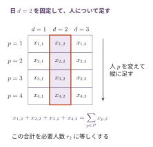
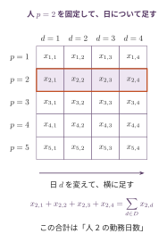
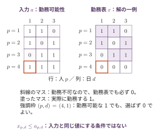

# 第07回　勤務表を数理モデルとして解く

売店の勤務表を題材に、人と日の組ごとの決定を0と1で表し、日ごとの人数・人ごとの日数・技能を持つ人の人数という、対象の違う集計を使い分ける。

## 目標 {.unnumbered}

この回を終えると、次の三つができるようになる。どれも「答えが出せる」ことではなく、「なぜその式なのかを説明できる」ことを指している。

- 入力・決定変数・制約を区別し、数式の意味を説明できる。
- 日について足すのか人について足すのかを選んで制約を書ける。
- 条件を足して解き直し、出力がその条件を満たすか自分で確かめられる。

決定変数、二次元配列、`sum`、`forall`は既習として振り返る。前回の演習が終わっていなくてよく、完成した出発ファイルを配るので、そこから始められる。実演を写し取れなくても演習には進める。提出はなく、教員の確認を待つ必要もない。

座学と実演に40分、各自の演習に55分、振り返りに5分を使う。手を動かすのは[5. 演習](#演習)からで、先に読み進めてもよい。配布物は基本モデル`roster-basic.mzn`、入力`base.dzn`と`practice.dzn`、技能の入力`skill.dzn`、演習の出発ファイル`practice-start.mzn`と`skill-start.mzn`である。操作と全配布一覧は[勤務表の確認手引き](guides/roster-check.md)にある。

## 問題

まず、解きたい場面を読む。ここから先の節は、すべてこの場面を数学の問題として扱ったものである。

::: scenario
来週の火・水・木に臨時の売店を開く。候補者はA・B・C・Dの四人で、全員が同じ仕事を担当できる。各日は10時から13時までの一枠で、途中の交代はない。誰がどの日に勤務できるかは、あらかじめ聞き取ってある。

各日に勤務できる人をちょうど二人ずつ選び、勤務表を一つ作りたい。学業と両立できるよう、一人にお願いする勤務は三日間で二日までとする。
:::

場面には書かれていることが多いので、今回扱う条件を四つに絞る。

::: {.given label="条件"}
期間と時間帯は火・水・木の三日間で、各日は一枠のみ。候補者はA・B・C・Dの四人で、全員が同じ仕事を担当できる。各日の人数はちょうど二人。一人あたりの日数は二日まで。誰がどの日に勤務できるかは、次の節の入力で与える。勤務できても必ず選ぶわけではない。
:::

この四つ以外は扱わない。勤務回数の公平さや、誰を優先するかという基準は入れず、条件を満たす案を一つ求めるところまでとする。

一日が一枠なので、人と日の組ごとに勤務するかどうかを決めれば勤務表になる。途中で交代する場合は時間枠も区別する別の問題になるが、今回は扱わない。

## 定式化

条件を、計算機に渡せる形へ写す。人の添字集合を $P=\{1,\ldots,n\}$、日の添字集合を $D=\{1,\ldots,m\}$ とし、入力と決定変数を名前で区別するところから始める。

### 入力と決定変数

入力は三つある。$a_{p,d}$ は人 $p$ が日 $d$ に勤務可能なら1、不可能なら0。$r_d$ は日 $d$ に必要な人数。$u_p$ は人 $p$ の勤務日数の上限である。求めるものは勤務表で、二値の変数 $x_{p,d}$ で表す。値1が勤務、値0が休みである。

解説例で使う値は次のとおりである。

::: {.given label="入力"}
$n=4$、$m=3$、$r=(2,2,2)$、$u=(2,2,2,2)$ とし、行列 $a$ は次のとおり。行はA・B・C・D、列は火・水・木の順とする。

$$
a=\begin{pmatrix}
1&1&0\\
1&0&1\\
0&1&1\\
1&1&1
\end{pmatrix}.
$$
:::

この行列を読むときに、一つ取り違えやすいところがある。$a$ と $x$ はどちらも同じ形の0と1の表だが、片方は与えられていて動かず、もう片方はこれから決める。

::: point
$a_{2,1}=1$ は人2が日1に勤務できるという入力の事実であって、人2を日1に選ぶという決定ではない。決めるのは $x$ の側だけで、$a$ は動かない。
:::

### 四つの条件

入力が決まったので、あとは満たすべき条件を式にすればよい。ここまでで名前を付けた $a$、$r$、$u$、$x$ を使って、勤務表が満たすべきことを四つの式に書き下す。求めるものは次のとおりである。

::: {.given label="求めるもの"}
次の四つをすべて満たす行列 $x$ を一つ求める。

$$x_{p,d}\in\{0,1\},\qquad
\sum_{p\in P}x_{p,d}=r_d,\qquad
x_{p,d}\le a_{p,d},\qquad
\sum_{d\in D}x_{p,d}\le u_p.$$

左から順に式(1)から式(4)と呼ぶ。式(2)はすべての日 $d$ に、式(3)はすべての組 $(p,d)$ に、式(4)はすべての人 $p$ に課す。
:::

良い表を選ぶ基準は置かないので、目的関数は設けない。

四つの式が何を言っているかを読んでいく。式(1)は変数の定義域である。式(2)は各日の人数で、日 $d$ を固定して人について足す。式(3)は勤務可能性で、入力が0の位置を0に固定する。式(4)は各人の日数の上限で、人 $p$ を固定して日について足す。

式(2)と式(4)は、どちらも $x$ の値を足す点では同じだが、固定する添字が違う。式(2)は列を、式(4)は行を見ている。以下の列の図は四人・三日、行の図は五人・四日へ広げた例である。表の大きさが変わっても、固定する添字と動かす添字の役割は同じになる。





式(3)を等号 $x_{p,d}=a_{p,d}$ にすると、勤務できる人を全員選ぶことになってしまう。可能と選択を分けるために不等号を使う。同じように、式(4)を等号にすると全員がちょうど二日になり、後で見るように解がなくなる。



## 解説例

数式の名前とMiniZincの名前を対応させながら、宣言・条件・実行の順に書く。ここは教員が実演する。

| 数式 | MiniZinc | 役割 |
|---|---|---|
| $P,D$ | `PEOPLE`, `DAYS` | 人と日の添字集合 |
| $a_{p,d}$ | `available[p,d]`{.minizinc} | 入力の勤務可能性 |
| $r_d$ | `required[d]`{.minizinc} | 入力の必要人数 |
| $u_p$ | `max_days[p]`{.minizinc} | 入力の日数上限 |
| $x_{p,d}$ | `work[p,d]`{.minizinc} | ソルバーが決める勤務有無 |

### 手順1　入力と決定変数を宣言する

入力には`var`{.minizinc}を付けず、決めてほしいものだけに付ける。この一文字が、動かせない値と動かしてよい値の区別になる。式(1)は定義域`0..1`{.minizinc}として書く。

```{.minizinc filename="roster-basic.mzn"}
array[PEOPLE, DAYS] of 0..1: available;
array[PEOPLE] of int: max_days;

% 式(1)：人と日ごとの勤務有無
array[PEOPLE, DAYS] of var 0..1: work;
```

### 手順2　三つの条件を書く

`sum`で足す範囲を決め、`forall`でその条件を全体へ広げる。式(2)は日ごと、式(3)は人と日の組ごと、式(4)は人ごとに課す。`sum`の中を見て、どの添字が動いているかを確かめよう。

```{.minizinc filename="roster-basic.mzn"}
constraint forall(d in DAYS)(
    sum(p in PEOPLE)(work[p,d]) = required[d]
);
constraint forall(p in PEOPLE, d in DAYS)(
    work[p,d] <= available[p,d]
);
constraint forall(p in PEOPLE)(
    sum(d in DAYS)(work[p,d]) <= max_days[p]
);
```

### 手順3　入力を与えて実行する

[基本モデル](../../../workbook/sessions/07-schedule/roster-basic.mzn)と[解説例の入力](../../../workbook/sessions/07-schedule/base.dzn)を保存し、Playgroundなら新しいモデルへ両方を貼る。`solve satisfy;`{.minizinc}は条件を満たす解を一つ求める指定で、`output`は表示だけを担当し、許す解の範囲を変えない。

::: ask
実行する前に予想しよう。四人のうち、一度も勤務しない人が出るだろうか。出るとしたら、それは条件に違反しているだろうか。
:::

```sh
minizinc --solver gecode roster-basic.mzn base.dzn
```

## 結果

出力を、式(2)から式(4)と一つずつ照らし合わせる。答えが出たことと、答えが正しいことは別なので、必ず自分の目で数える。

```text
人 火 水 木
A  1  1  0
B  1  0  1
C  0  1  1
D  0  0  0
```

各列の合計はいずれも2で、式(2)を満たす。入力で0だった位置、たとえば人1の木曜は出力でも0で、式(3)を満たす。各行の合計は上から2・2・2・0で、いずれも2以下だから式(4)を満たす。

::: check
自分の出力がこの表と違っても誤りとは限らない。三つの条件をすべて満たす表は複数ある。列の合計・禁止位置・行の合計の三つを数えて、すべて通れば正しい解である。
:::

人4が一度も選ばれていないが、これは条件への違反ではない。式に書いていない条件を、ソルバーが気を利かせて守ってくれることはないからである。Dを必ず一日は入れたいなら、そう書かないかぎり結果には表れない。

::: ask
Dが一日も入らない表を避けたいとする。それは条件が足りないのだろうか、それとも良い表の基準がまだ決まっていないのだろうか。
:::

条件を足す方向で考えると、全員に同じだけ働いてもらう案が浮かぶ。ところが、この案は式(4)の書き方を一つ変えるだけで解が消えてしまう。上限と等号の違いは、この回でいちばん取り違えやすいところである。

::: caution
全員をちょうど二日にしようとして式(4)を等号にすると、解がなくなる。四人で合計八人日を要求する一方、三日間に必要な人数は六人日しかないためである。
:::

必修2では、技能を持つ勤務者の人数を数える。例えばA・Bだけが技能を持つ場合、上の表の火曜は2人、水曜は1人になる。技能の有無を0/1の入力とし、その人の勤務の0/1値を掛けると、技能のない人の項を0にできる。第06回の「係数×選択」と同じ考え方である。

## 演習

必修1は解説例と同じ構造の問題を、少し大きい入力で自分で組む。必修2はそこへ技能の条件を足す。どちらも[2. 定式化](#定式化)の式に戻りながら進めてよい。

### 必修1　五人・四日の勤務表

五人の勤務可能日から、四日分の勤務表を一つ作る。勤務できる日でも休んでよいことと、毎日必要な人数をそろえることを、別々の条件として表す。

#### 問題

::: scenario
営業が四日間に延び、応援のEさんが加わった。五人から新しい勤務可能日を集めたので、各日ちょうど二人、一人二日までという条件で組み直す。
:::

::: {.given label="条件と入力"}
人の集合 $P$ はA〜Eの5人、日の集合 $D$ は日1〜4である。$x_{p,d}$ は人pが日dに勤務するなら1、休むなら0の決定変数、$a_{p,d}$ は勤務できるなら1、できないなら0の入力を表す。$r_d$ は日dの必要人数、$u_p$ は人pの勤務日数の上限である。各日ちょうど2人を勤務可能な人から選び、各人の勤務は合計2日以下とする。

$P=\{1,\ldots,5\}$、$D=\{1,\ldots,4\}$、$r=(2,2,2,2)$、$u=(2,2,2,2,2)$ とし、勤務可能性 $a$ は行がA〜E、列が日1〜4の順で A=1101、B=1011、C=0111、D=1110、E=1111 とする。

次の四つをすべて満たす行列 $x$ を一つ求めよ。左から順に、変数の定義域、各日の人数、勤務可能性、各人の日数の上限である。

$$x_{p,d}\in\{0,1\},\qquad
\sum_{p\in P}x_{p,d}=r_d,\qquad
x_{p,d}\le a_{p,d},\qquad
\sum_{d\in D}x_{p,d}\le u_p.$$
:::

#### 作業

モデルでは `work[p,d]`{.minizinc} が $x_{p,d}$、`available[p,d]`{.minizinc} が $a_{p,d}$、`required[d]`{.minizinc} が $r_d$、`max_days[p]`{.minizinc} が $u_p$ に対応する。`PEOPLE=1..5`{.minizinc} はA〜E、`DAYS=1..4`{.minizinc} は日1〜4の番号である。

[出発ファイル](../../../workbook/sessions/07-schedule/practice-start.mzn)には入力の宣言と表示が入っている。[必修1の入力](../../../workbook/sessions/07-schedule/practice.dzn)を与え、次の四つを書き足す。人と日を数値で列挙せず、`PEOPLE`と`DAYS`で指定する。

```{.minizinc filename="practice-start.mzn"}
% TODO(作業1) 人と日ごとの勤務有無を表す決定変数 work を宣言する
% TODO(作業2) 各日の勤務人数を required[d] に一致させる
% TODO(作業3) 勤務できない位置を選ばないようにする
% TODO(作業4) 各人の勤務日数を max_days[p] 以下にする
```

#### 自己確認

各列の合計が2か、入力で0の位置が出力でも0か、各行の合計が2以下かを数える。三つとも通れば正解で、特定の表と一致する必要はない。この入力では条件を満たす表が393通りある。

::: {.hint summary="ヒントを開く：どの添字を固定して足すか"}
日別の人数を数えるときは表の一列、人別の日数を数えるときは一行を選ぶ。選んだ四角の中で変わる添字を`sum`、どの行・列にも同じ条件を課す対象を`forall`へ対応させる。日ごとの条件では `forall(d in DAYS)`{.minizinc} の中で人pについて足し、人ごとの条件では `forall(p in PEOPLE)`{.minizinc} の中で日dについて足す。
:::

::: {.hint summary="ヒントを開く：解が出ないときに見るところ"}
入力と決定変数を等号で結んでいないか、各人をちょうど二日にしていないかを見る。全員ちょうど二日にすると十人日を要求することになり、必要な八人日と両立しない。
:::

### 必修2　技能を持つ人を毎日確保する

五人で四日分の勤務表を作り、毎日の担当者にレジ締めの技能を持つ人を含める。勤務人数全体と、その中で技能を持つ人数を分けて数える。

#### 問題

::: scenario
売店ではレジ締めができる人が毎日一人は必要だとわかった。A・B・Cはこの技能を持ち、D・Eは持たない。
:::

::: {.given label="条件と入力"}
人の集合 $P$ はA〜Eの5人、日の集合 $D$ は日1〜4である。$x_{p,d}$ は人pが日dに勤務するなら1、休むなら0の決定変数、$a_{p,d}$ は勤務できるなら1、できないなら0の入力を表す。$r_d$ は日dの必要人数、$u_p$ は人pの勤務日数の上限である。各日ちょうど2人を勤務可能な人から選び、各人の勤務は合計2日以下とする。

具体的な入力は、$P=\{1,\ldots,5\}$、$D=\{1,\ldots,4\}$、$r=(2,2,2,2)$、$u=(2,2,2,2,2)$、勤務可能性 $a$ は A=1101、B=1011、C=0111、D=1110、E=1111。これに技能の有無 $s_p$ を加える。持つなら1、持たないなら0で、今回は $s=(1,1,1,0,0)$ である。

次の五つをすべて満たす行列 $x$ を一つ求めよ。最後の一つが今回加える条件で、技能を持つ勤務者が各日に少なくとも一人いることを表す。二人以上になってもよい。

$$x_{p,d}\in\{0,1\},\qquad
\sum_{p\in P}x_{p,d}=r_d,\qquad
x_{p,d}\le a_{p,d},\qquad
\sum_{d\in D}x_{p,d}\le u_p,\qquad
\sum_{p\in P}s_p x_{p,d}\ge1.$$
:::

#### 作業

モデルでは `work[p,d]`{.minizinc} が $x_{p,d}$、`available[p,d]`{.minizinc} が $a_{p,d}$、`required[d]`{.minizinc} が $r_d$、`max_days[p]`{.minizinc} が $u_p$ に対応する。`PEOPLE=1..5`{.minizinc} はA〜E、`DAYS=1..4`{.minizinc} は日1〜4の番号である。

[完成した基本モデル](../../../workbook/sessions/07-schedule/roster-basic.mzn)を `roster-skill.mzn` としてコピーし、[追加する部分の案内](../../../workbook/sessions/07-schedule/skill-start.mzn)にある二つの作業を書き足す。実行時には、上の勤務可能日・人数・日数上限を持つ [practice.dzn](../../../workbook/sessions/07-schedule/practice.dzn) と、技能の有無を持つ [skill.dzn](../../../workbook/sessions/07-schedule/skill.dzn) の両方を渡す。宣言する `skill[p]`{.minizinc} が $s_p$ に対応し、技能を持たない人の勤務は技能の人数に数えない。

```sh
minizinc --solver gecode roster-skill.mzn practice.dzn skill.dzn
```

```{.minizinc filename="skill-start.mzn"}
% TODO(作業1) 技能を持つかどうかの入力 skill を宣言する
% TODO(作業2) 各日、技能を持つ勤務者を少なくとも一人にする
```

#### 自己確認

次の二つの表で、自分のモデルが受理と拒否を正しく分けるかを確かめる。「AB／AD／CD／BC」は日1から順にAとB、AとD、CとD、BとCが勤務する意味で、日数の列はA〜Eの順である。どちらも勤務可能性・各日2人・各人2日以下を満たしている。違うのは技能の条件だけである。

| 各日の担当 | 人ごとの日数 | 技能を持つ人の数 | 期待 |
|---|---|---|---|
| AB／AD／CD／BC | 2, 2, 2, 2, 0 | 2, 1, 1, 2 | 受理 |
| DE／AC／BD／BC | 1, 2, 2, 2, 1 | 0, 2, 1, 2 | 拒否 |

編集したモデルに、担当者なら `constraint work[p,d] = 1;`{.minizinc}、それ以外なら `constraint work[p,d] = 0;`{.minizinc} を全20マス分一時的に加えて、一つずつ表を固定して実行する。二つ目を試す前に一つ目の固定条件を外し、通常の求解に戻るときはすべて外す。[表をまとめて固定する書き方](guides/roster-check.md#技能の固定検査)も使える。最初に出た一解を眺めるだけでは、技能条件の有無を確かめられない。

下の表を受理してしまうなら、技能の人数を数える対象がずれている。上の表を拒否してしまうなら、ちょうど一人に狭めていないかを見る。

::: {.hint summary="ヒントを開く：技能保有者が何人働くか"}
まず、ある日について「技能を持ち、かつその日に勤務する人」の数を式で書いてみる。日を固定して、人について足すことになる。
:::

::: {.hint summary="ヒントを開く：入力が0の人を数えない書き方"}
$s_p$ と $x_{p,d}$ を掛けると、技能を持たない人の項は0になる。掛けた値を足せば、技能を持つ勤務者の数になる。
:::

::: {.hint summary="ヒントを開く：少なくとも一人を表す比較"}
「少なくとも一人」は、その人数が1以上ということである。等号ではなく $\ge$ を使う。到達形は $\sum_{p} s_p x_{p,d}\ge1$ を各日に課したものになる。
:::

## 発展

自分の関心に合わせて選ぶ。三問とも独立して読めるようにしてあり、全部を終えることは前提にしない。次の通常回はこの発展を前提にしない。

| 問題 | 出発点 | 考えること |
|---|---|---|
| [発展1　同じ日に選べない二人](advanced-exercises.md#pair) | 技能なしの必修1 | 二つの変数の和で排他を表す |
| [発展2　二種類の技能を確保する](advanced-exercises.md#skills) | 技能なしの必修1 | 一人が二つの技能に数えられてよい |
| [発展3　周期的な勤務表と、作れる期間の限界](advanced-exercises.md#cycle) | 新しい入力と条件 | 境界をまたぐ隣接と、可能な期間の上限 |

## 振り返り

今回は、勤務できるという入力と勤務するという決定を分け、日について足す条件と人について足す条件を書き分けた。条件を足すほど、許される表は狭くなる。

::: ask
上限を守った表が「最も公平な表」とは限らない。条件を満たす複数の案から一つを選ぶには、何を基準にすればよいだろうか。
:::

この問いは第08回の最適化へ続く。第08回は技能の条件を含まない必修1の入力と完成モデルから始めるので、[6. 発展](#発展)を終えていなくても差し支えない。

## 参照 {.unnumbered}

この回で使うファイルと、出てきた言葉をまとめる。演習の途中で必要になったときに、ここへ戻って引けばよい。読み進める順番の中には入っていない。

| ファイル | 使いどころ |
|---|---|
| [roster-basic.mzn](../../../workbook/sessions/07-schedule/roster-basic.mzn) | 解説例で完成させる基本モデル |
| [base.dzn](../../../workbook/sessions/07-schedule/base.dzn) | 解説例の入力。四人・三日 |
| [practice.dzn](../../../workbook/sessions/07-schedule/practice.dzn) | 必修1・必修2の入力。五人・四日 |
| [skill.dzn](../../../workbook/sessions/07-schedule/skill.dzn) | 必修2の技能の入力 |
| [practice-start.mzn](../../../workbook/sessions/07-schedule/practice-start.mzn) | 必修1の出発ファイル |
| [skill-start.mzn](../../../workbook/sessions/07-schedule/skill-start.mzn) | 必修2の出発ファイル |

**決定変数**はソルバーが値を決めるもので、MiniZincでは`var`{.minizinc}を付ける。**入力**は与えられて動かない値である。**実行可能解**は、すべての条件を満たす値の組をいう。今回は目的関数を置かないので、実行可能解が一つ見つかれば終わりである。

::: caution
`sum`の中で動く添字と、`forall`で固定する添字を取り違えると、行と列を数え違える。式(2)と式(4)を見比べて、どちらを固定しているかを確かめる。
:::
