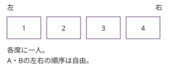

# 第10回の発展　期限・装置・別表現の検査

[第10回の本文](lesson.md)から、最小の期限、装置の選択、一般の日程モデルへ進む。各問題には独立した条件と出発点があり、前の発展の完成は不要である。日程以外を選びたい場合は、席順と覆面算にも取り組める。

入力の一覧、実行方法、開始時刻の固定、結果の読み方は[確認手引き](guides/schedule-check.md)で確認できる。最適値を求める問題では、成立例と、それより小さい値が不可能な理由を分けて確かめよう。

## 発展1　最小の期限 {#deadline}

期限を変えて充足可能性を調べ、成立する最小の期限を探す。目的のための新しいAPIを導入する代わりに、本文と同じSAT判定を何度か使う。各判定は新しいソルバーで行う。

### 条件と探索範囲

三作業A・B・Cの所要時間はそれぞれ2・3・2。開始は0以上の整数で中断しない。AとCは同じ装置で重ならず、Aの終了後にBを始める。Bは別の場所なのでCと重なってよい。各作業を期限H以内に終了し、端点での接触を許す。

求めるのは、以上を満たす日程が存在する最小の整数Hである。必修1の変更時間や必修2のC→Bは引き継がない。[deadline-start.py](../../../workbook/sessions/10-smt/deadline-start.py)と完成した[schedule_base.py](../../../workbook/sessions/10-smt/schedule_base.py)、[integer_io.py](../../../workbook/sessions/10-smt/integer_io.py)を使う。

`at_deadline(H)`{.python}は、SATなら開始時刻の辞書、UNSATなら`None`を返す。UNKNOWNでは判定未完了として例外を出す。ソルバー呼出しの部分は提供するので、探索範囲と期限の動かし方を考える。

1. **作業1：** 所要時間と先行関係から下限を、必ず作れる日程から上限を決める。
2. **作業2：** 期限を順に試すか、成立性が単調であることを使って二分探索し、最小期限と成立する日程を返す。
3. 見つけた最小期限の一つ前を別に判定し、UNSATの理由を説明する。

同時に進められない先行関係をたどると、必要時間の下限を得られる。上限は、先行を守って全作業を一つずつ実施する日程から作れる。下限と上限が、そのまま同じ意味の値とは限らない。

完成した `minimum_deadline()`{.python} を `python3 deadline-start.py` で実行する。求めた期限の成立例と、一つ前の期限のUNSATを確かめてから、次の確認例を開く。

::: {.hint summary="確認例を開く：期限の値と日程"}
最小期限は5で、開始(A,B,C)=(0,2,2)ならAが[0,2)、Bが[2,5)、Cが[2,4)となる。期限4ではA→Bの合計5時間だけでも間に合わない。
:::

期限を延ばしても、同じ開始時刻を使えば既存の条件は保たれる。作業・所要時間・資源・先行を変えず、終了上限だけを緩めることが、この単調性の前提である。

## 発展2　装置も選ぶ日程 {#machines}

作業ごとの開始に加え、どの装置を使うかも決める。装置が別なら同時に動かせるため、すべての作業を一列に並べるモデルでは、問題が許す日程を失ってしまう。

### 条件と論理和

同じ性能の装置1・2があり、三作業A・B・Cの所要時間はすべて3。各作業はどちらか一台を選び、途中で装置を替えず、中断せずに行う。開始は0以上の整数、同じ装置の作業は重ならない。先行関係はない。

すべて期限Hまでに終了し、端点で接してよい。H=5とH=6を別々に判定する。開始時刻sに加え、装置番号mを整数1〜2で決める。[machines-start.py](../../../workbook/sessions/10-smt/machines-start.py)と[integer_io.py](../../../workbook/sessions/10-smt/integer_io.py)、[期限5](../../../workbook/sessions/10-smt/machines-5.json)・[期限6](../../../workbook/sessions/10-smt/machines-6.json)の入力を使う。

モデルの `start[a]`{.python} は作業aの開始変数、`machine[a]`{.python} は装置番号の変数、`data['duration'][a]`{.python} はその所要時間である。開始範囲、装置番号の範囲、全作業ペアを巡回する枠は提供する。**作業1：** 各ペアa・bについて、装置が同じ場合と異なる場合に許す重なりを分け、条件を書く。

**作業2：** 二つの期限で実行し、装置が違う作業の重なりが許されているかも確かめる。出力のsA・sB・sCは開始、mA・mB・mCは装置番号である。装置番号の大小を作業順序として使わない。

```sh
python3 machines-start.py machines-5.json
python3 machines-start.py machines-6.json
```

::: {.hint summary="ヒントを開く：装置が違う場合も許す"}
同じ装置なら、二つの作業をどちらかの順序へ分ける必要がある。別装置なら、その二つの順序を守らない重なりも許したい。装置の違いを、順序の条件へ「かつ」「または」のどちらで結べばよいか考えよう。
:::

::: {.hint summary="確認例を開く：装置と順序の論理和"}
一つの`Or`へ、`machine[a] != machine[b]`{.python}、aの終了≤bの開始、bの終了≤aの開始を入れる。装置が同じなら最初の式は偽なので、残る二つの順序のどちらかが必要になる。
:::

二つの期限の判定を比較し、成立する場合は同時に進む作業の装置を確認する。成立しない場合は、総作業時間と全装置の時間の総量だけで説明できるか、作業を分割できない条件も使って考えよう。

::: {.hint summary="確認例を開く：二つの期限と不可能性"}
期限5はUNSAT、6はSAT。例えばAを装置1で[0,3)、Bを装置2で[0,3)、Cを装置1で[3,6)とできる。AとBが同時でも別装置なので許される。

総作業時間9が装置2台×期限5の10以下でも十分ではない。三作業を二台へ割り当てると、どちらか一台は少なくとも二作業を担当し、その装置には中断できない3時間の作業が二つ必要になる。この6時間を期限5へ収められない。
:::

## 発展3　一般の日程と独立した検査 {#jobshop}

作業1のモデルだけを記入した段階でも実行できる。検査器が未実装なら「独立検査: 未実装（妥当性は未確認）」と表示される。これは検査成功を意味しない。まず元の入力で開始・終了を確認し、その後で作業2の独立検査と一般化へ進もう。

固定した作業名の式を書くところから、入力を読んで条件を生成するところへ進む。同じ日程を、モデルでは同じ装置の各ペア、検査器では各時刻の装置使用数という別の表し方で調べる。

### 二つの仕事と入力形式

仕事1はA→B、仕事2はC→Dの順に実施する。開始は0以上の整数で、作業は中断しない。各装置は同時に一作業だけを行い、端点で接してよい。各作業を期限Hまでに終了する。

| 作業 | 装置 | 所要時間 | 先行する作業 |
|---|---:|---:|---|
| A | 1 | 2 | なし |
| B | 2 | 3 | A |
| C | 2 | 2 | なし |
| D | 1 | 1 | C |

[jobshop.json](../../../workbook/sessions/10-smt/jobshop.json)がH=5の入力。[jobshop-long.json](../../../workbook/sessions/10-smt/jobshop-long.json)はCだけ4時間へ変え、H=7にした比較入力である。作業名・装置番号・所要時間・先行辺・期限をデータとして扱い、A〜D専用の制約にしない。

[jobshop-start.py](../../../workbook/sessions/10-smt/jobshop-start.py)、[jobshop_tools.py](../../../workbook/sessions/10-smt/jobshop_tools.py)、[integer_io.py](../../../workbook/sessions/10-smt/integer_io.py)を使う。入力では所要時間と装置番号は正整数、期限は非負整数、作業名は重複しない文字列とする。装置番号が1・2以外でも入力から扱う。

入力辞書 `data` の `tasks` は作業のリストで、各要素の `name` が作業名、`machine` が装置番号、`duration` が所要時間である。`precedence` は先行辺のリストで、例えば `["A","B"]`{.python} はAの終了後にBを始める意味、`H` が期限である。上の表はこの形式の入力を読みやすく示したものになる。

### モデルの生成

`build(data)`{.python}には作業名から整数開始変数への辞書 `starts` とソルバー `s` を用意した。**作業1：** 作業の開始範囲、先行辺ごとの終了≤開始、同じ装置を使う全ペアの非重複を入力から生成する。

装置が同じかどうかは入力値の比較なので、Pythonの`if`{.python}でペアを選別してよい。一方、未定の開始時刻の比較はZ3へ渡す式であり、Pythonの`if`{.python}で真偽を決めない。

先行辺のない作業や、他と装置を共有しない作業にも開始範囲は必要である。必ず四作業がある、装置番号が連続する、入力の配列順が仕事の順序だといった仮定を追加しない。

### 時刻ごとの検査

`valid_schedule(data, starts)`{.python}は、名前からPythonの整数開始時刻への辞書を受け取り、妥当ならTrue、違反ならFalseを返す。**作業2：** 範囲と先行を確認し、各整数時刻tで各装置を使用中の作業数を数える。

$s_i$ を作業iの開始、$d_i$ を所要時間とすると、作業iが時刻tの区間を使っている条件は $s_i\le t<s_i+d_i$。t=0〜H−1を調べ、各装置の使用数が1以下か確認する。モデルのペアの論理和をそのまま転記して検査器としない。

::: {.hint summary="ヒントを開く：単位時間ごとの使用数"}
入力の作業を巡回し、tがその作業の半開区間に入るなら、装置番号をキーにした回数を増やす。同じ時刻・同じ装置で2以上なら違反。終了時刻には加えないので、端点で接する二作業を重複と数えない。
:::

元の入力の最小期限は5。例えば開始(A,B,C,D)=(0,2,0,2)で成立し、A→Bに合計5時間必要なため4では不可能である。Cを4時間にした入力では、装置2のCとBに計7時間必要となり、最小期限は7。開始(0,4,0,4)が達成する。

### 全解集合の比較

[jobshop_tools.py](../../../workbook/sessions/10-smt/jobshop_tools.py)の`finite_starts(data)`{.python}は、各作業の安全な開始範囲の全組合せを返す。提供する[jobshop-compare.py](../../../workbook/sessions/10-smt/jobshop-compare.py)で、独立検査器に通る有限列挙と、SMTの全解集合を照合できる。

```sh
python3 jobshop-start.py jobshop.json
python3 jobshop-compare.py jobshop-start.py
```

[jobshop-cases.json](../../../workbook/sessions/10-smt/jobshop-cases.json)は八つの入力を持つ。元の二入力、期限を一つ短くした二入力、作業なし、単独作業の期限不足、先行の循環、別の作業名・装置番号の入力である。八入力の具体的な違いと期待解数を次に示す。「元」は上の四作業の表で、指定した項目以外は変えない。

| 入力 | 作業・先行の設定 | H | 解数 |
|---|---|---:|---:|
| 1 | 元の四作業 | 5 | 3 |
| 2 | 元のCを4時間へ変更 | 7 | 9 |
| 3 | 元の四作業 | 4 | 0 |
| 4 | 元のCを4時間へ変更 | 6 | 0 |
| 5 | 作業なし・先行なし | 0 | 1 |
| 6 | X：装置2・所要2、先行なし | 1 | 0 |
| 7 | X・Y：ともに装置1・所要1、X→YとY→X | 3 | 0 |
| 8 | P：装置7・所要2、Q：装置3・所要1、R：装置7・所要1、Q→R | 4 | 9 |

作業なしの場合は空の日程一つが成立する。先行の循環は、正の所要時間を持つ作業が互いの終了を待つため解がなくなる。

集合が違ったら、SMTだけが許した日程と、列挙だけが許した日程を出力から調べる。両実装に同じ誤りがある場合は一致してしまうので、既知の端点・重なり・期限不足と、上の解数も併用する。UNKNOWNを全列挙完了として扱わない。

開始と所要時間が整数なら、重なる区間には共通する整数の単位時間がある。したがって同じ装置のペアが重ならないことと、各整数時刻の使用数が1以下であることが対応する。実数時刻へ変えた場合に、整数時刻だけの検査が十分とは限らない理由も説明しよう。

## 選択T10　四人の席順 {#seats}

開始時刻の代わりに席の位置を整数で表す。隣り合う二つの向き、端の二候補、左にいるという順序を組み合わせる、15〜20分を目安とした別題材である。

### 条件と作業

左から1〜4の四席へA・B・C・Dを一人ずつ座らせる。席を共有せず、AとBは隣り合い、左右の順序はどちらでもよい。Cは端、DはAより左に座る。すべての条件を満たす一つの席順を求め、目的関数は置かない。



[seats-start.py](../../../workbook/sessions/10-smt/seats-start.py)と[integer_io.py](../../../workbook/sessions/10-smt/integer_io.py)を使う。`posA`・`posB`・`posC`・`posD` はA・B・C・Dの席番号を表す整数変数である。この宣言と表示を提供し、学習者が位置の範囲・不一致・三条件を追加する。

1. **作業1：** 全員の位置を1〜4とし、すべてのペアの位置を異ならせる。
2. **作業2：** A・Bが隣り合う二つの向き、Cが端である二つの候補、DがAより左という条件を書く。

`Or`で二つの向きを表せる。全ペアの不一致は`Distinct(posA,posB,posC,posD)`{.python}とも書け、これは引数のすべての値が互いに異なるという意味である。今回の演習内でこの記法を使ってよい。

::: {.hint summary="ヒントを開く：隣接と左右"}
Aの位置+1がB、またはBの位置+1がAなら隣接する。Cの端は1または4。Dが左ならDの位置<Aの位置である。単にAとBの位置を異ならせるだけでは隣接にならない。
:::

位置(A,B,C,D)は(2,3,4,1)、(3,2,4,1)、(3,4,1,2)、(4,3,1,2)の四通り。例えば(4,2,1,3)は他の条件を満たすがA・Bが隣接せず、拒否される。[固定位置の確認例](../../../workbook/sessions/10-smt/seats-checks.json)も使える。確認値はA・B・C・Dの順で、モデルの判定前に各変数との等式を一時追加する。例えば拒否例では `s.add(posA == 4, posB == 2, posC == 1, posD == 3)`{.python} とする。固定を外してから通常の求解へ戻る。

## 選択M04のZ3版　覆面算 {#send-more}

八文字へ数字を割り当て、筆算が成立するようにする。MiniZinc版の完成は前提にせず、整数の上下限・全相異なり・算術等式という三種類の条件を、この問題から組み立てる。

### 条件と桁の重み

同じ文字は同じ数字、異なる文字は異なる数字を表す。各数字は0〜9、先頭のSとMは0以外とする。次の加算が成立する割当を求める。数独の行・列・ブロックの条件は使わない。

```text
  SEND
+ MORE
------
 MONEY
```

[send-more-start.py](../../../workbook/sessions/10-smt/send-more-start.py)と[integer_io.py](../../../workbook/sessions/10-smt/integer_io.py)を使う。八文字を一つずつ整数記号として宣言し、三つの数を表示する足場を提供している。

| 数 | 桁の重みを使った式 |
|---|---|
| SEND | 1000S+100E+10N+D |
| MORE | 1000M+100O+10R+E |
| MONEY | 10000M+1000O+100N+10E+Y |

1. **作業1：** 数字の範囲、S・Mの非ゼロ、八文字の全相異なりを追加する。
2. **作業2：** 三つの数を桁の重みで表し、SEND+MORE=MONEYの等式を追加する。

`Distinct(S,E,N,D,M,O,R,Y)`{.python}は八変数の値がすべて異なるという意味である。これで同じ文字の出現ごとに別の数字を割り当てるのではなく、一つの記号を桁の式の中で再利用する。

唯一の解は9567+1085=10652で、文字順(S,E,N,D,M,O,R,Y)は(9,5,6,7,1,0,8,2)となる。[確認用の割当](../../../workbook/sessions/10-smt/send-checks.json)では、先頭ゼロの2817+0368=03185と、重複数字を使った9000+1000=10000を拒否できるかも調べられる。

足し算だけが合っていても、文字の条件を守った解とは限らない。確認用の `digits` はS・E・N・D・M・O・R・Yの順で、各変数と対応する数字の等式を判定前に一時追加して一例ずつ固定する。例えば先頭ゼロ例のMには `s.add(M == 0)`{.python} を加え、残り七文字も同じように固定する。例を交換するときは前の固定を外す。先頭ゼロと全相異なりの違反を別々に確認し、どの制約の役割かを説明しよう。

MiniZinc版も試した人は、数字の範囲・全相異なり・桁の等式に対応する箇所を並べ、同じ数字の割当を許す理由を説明してみよう。両版の完成を求める追加課題ではない。
