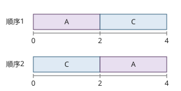
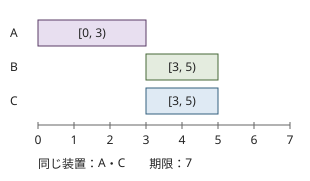

# 第10回　SMTで作業の日程を組む

作業をいつ始めるかを整数で決め、必要な順序と装置の使い方を守る日程を探す。作業の開始と終了を時間軸へ戻し、同じ装置の使用が重ならないことと、すべて期限内に終わることを確かめる。

## 目標 {.unnumbered}

この回では、論理式に整数の時刻と不等式を組み合わせる。日程を表示できたら、次の三つを説明できるようになろう。

- 開始時刻の意味と、終了期限から導いた安全な上限を説明できる。
- 先行関係と、二つの順序を許す非重複を式にできる。
- 得られた時刻を区間で確認し、期限不足によるUNSATの理由を説明できる。

第09回のPython・Z3、条件追加・判定・モデル取得、論理和を使う。[Booleanの操作例](../../../workbook/sessions/10-smt/warmup.py)と[判定の足場](../../../workbook/sessions/10-smt/sat_io.py)を再配布し、整数を読む処理は[integer_io.py](../../../workbook/sessions/10-smt/integer_io.py)へ用意した。整数の変数と区間はこの回で説明する。前の発展の完成は不要で、環境は[確認手引き](guides/schedule-check.md)で授業内に確認できる。

説明・実演に50分、[5. 演習](#演習)に45分、振り返りに5分を使う。必修1・2は各20分、残り5分は確認の目安である。通常演習の提出・宿題・完了報告・教員の完了承認は設けない。発展は関心に合わせて選ぶ。

## 問題

一つの装置を共有する作業は、同時に実行できない。一方、別の場所で行う作業は、必要な先行関係を守れば重ねられる。すべての作業を順番に並べると決め付けず、指定された関係を読み取ろう。

::: {.given label="条件と入力"}
三つの作業A・B・Cをすべて実施する。時間の単位を揃え、所要時間と使用場所を次のように与える。

| 作業 | 内容 | 所要時間 | 場所 |
|---|---|---:|---|
| A | 試料の処理 | 2 | 装置 |
| B | 結果の確認 | 3 | 別の作業場所 |
| C | 別試料の処理 | 2 | Aと同じ装置 |

開始時刻は0以上の整数、作業は途中で中断しない。期限H=7までにすべて終了する。Aが終わってからBを始め、AとCは重ねない。AとCの順序はどちらでもよく、BとCの重なりは禁止しない。

作業は開始時刻を含み、終了時刻を含まない区間として扱う。終了と次の開始が同じ時刻でもよい。以上を満たす一つの日程を求め、最短化の目的は置かない。
:::

求めるのは各作業の開始時刻で、所要時間は入力である。開始時刻を求めれば、終了時刻は開始と所要時間の和で決まる。場所を共有するA・Cと、順序が指定されたA・Bを分けて読む。

## 定式化

第09回の真偽値に加え、今回は整数の意味を持つ式を使う。命題論理と、整数の算術などの意味を持つ制約を組み合わせた充足可能性をSMTと呼ぶ。APIの基本的な流れは、変数を作る、式を加える、判定する、値を読むという順のままである。

### 開始・終了・期限

作業iの開始時刻を整数 $s_i$、入力の所要時間を $d_i$ とする。作業を中断しないので、実行中の区間は $[s_i,s_i+d_i)$ になる。左端の開始を含み、右端の終了を含まない**半開区間**である。

開始の下限と、すべての終了が期限H以下である条件は次のようになる。終了時刻そのものをHへ固定するのではなく、それ以前に終わってもよい。

$$0\le s_i,\qquad s_i+d_i\le H\quad(各作業i).$$

終了上限を移項すると $s_i\le H-d_i$ なので、開始時刻の範囲は $0\le s_i\le H-d_i$ となる。解説例ではA・Cの上限は5、Bは4。いずれも元の終了条件から導いた上限である。

Hが所要時間より小さい場合、上限H−dは負になる。開始0以上と両立しないため、その作業だけでも期限内に終えられない。根拠なく狭い上限を置く方法とは異なり、この境界で正しい日程を失うことはない。

### 先行と非重複

Aが終わってからBを始める条件は $s_A+d_A\le s_B$ である。この先行関係では順序が指定される。一方、AとCの装置共有では、どちらを先にするかを決めることも日程の選択に含まれる。

$$ (s_A+d_A\le s_C)\ \lor\ (s_C+d_C\le s_A).$$

左はAの終了後にC、右はCの終了後にAである。いずれかの順序が成り立てば、区間が重ならない。両方を同時に要求する連言ではなく、どちらかを選べる論理和にする。



開始時刻が異なるだけでは十分ではない。Aが[0,2)、Cが[1,3)なら開始は違うが、時刻1〜2に重なる。終了まで含めて比べること、端点が接するときに`<=`{.python}で許すことを確認しよう。

### 整数の記号と値

Z3の`Int`は整数の記号を作り、`Ints`は複数の整数記号をまとめて作る。開始時刻に整数を選ぶ今回の問題では、例えば0・1・2を使え、0.5という開始時刻は含まない。

整数の記号自体には、宣言だけで0以上や期限内という範囲が付くわけではない。下限と上限は明示的に加える。実数なら分数の時刻も含み、固定ビット幅の数ならさらに別の意味になるが、今回の入力は整数時刻に揃える。

`Or`の中には真偽変数だけでなく、整数の比較式も置ける。比較式全体は真偽を持つので、第09回と同じ論理和で二つの順序を結べる。[解説例](#解説例)で、どの式がどの時刻を比べているかを追ってみよう。

## 解説例

教員が所要時間と期限を読み、整数変数、開始範囲、先行と非重複を順に書く。モデルがSATになったら、値を得るだけでなく、開始と終了を区間として読み直して確認する。

### 手順1　開始時刻と境界

[schedule-demo.py](../../../workbook/sessions/10-smt/schedule-demo.py)を[demo.json](../../../workbook/sessions/10-smt/demo.json)で実行する。所要時間`dA,dB,dC`と期限`H`は入力から読み、開始時刻だけを未知の整数として宣言する。

```{.python filename="schedule-demo.py"}
    sA, sB, sC = Ints('sA sB sC')
    s = Solver()
    s.add(0 <= sA, sA <= H-dA)
    s.add(0 <= sB, sB <= H-dB)
    s.add(0 <= sC, sC <= H-dC)
```

`H-dA`{.python}などは、入力が変われば変わる値である。今回の上限5や4を固定で埋め込むよりも、期限と所要時間の関係をそのまま書けばよい。二つの不等式を`s.add`{.python}へ別々に渡し、Pythonの連鎖比較`0 <= sA <= H-dA`{.python}にはしない。

### 手順2　先行と非重複

Aの終了とBの開始を比べて先行関係を加え、装置を共有するA・Cには二つの順序を許す条件を加える。各式の左辺・右辺が、開始か終了かを読み分けよう。

```{.python filename="schedule-demo.py"}
    s.add(sA+dA <= sB)
    s.add(Or(sA+dA <= sC, sC+dC <= sA))
```

BとCの重なりは指定されていないので、そのペアの非重複は追加しない。A→Bの矢印を逆にせず、A・Cの順序を一方向へ決め打ちしていないことを、問題の条件へ戻って確認する。

### 手順3　判定と区間の確認

[integer_io.py](../../../workbook/sessions/10-smt/integer_io.py)が第09回と同じ三分岐で結果を扱う。SATの場合だけモデルを読み、整数の値を`as_long()`{.python}でPythonの整数へ取り出す。UNSAT・UNKNOWNでは充足する日程を表示しない。

```{.python filename="integer_io.py"}
    result = solver.check()
    if result == sat:
        model = solver.model()
        values = {name: model.evaluate(var, model_completion=True).as_long()
                  for name, var in variables.items()}
```

作業フォルダーにモデル・入力・共通ファイルを置き、次を実行する。出力には開始時刻と、入力の所要時間を足した半開区間が表示される。

```sh
python3 schedule-demo.py demo.json
python3 schedule-demo.py demo-4.json
```

二つ目の[demo-4.json](../../../workbook/sessions/10-smt/demo-4.json)は所要時間を保ち期限だけを4へ変えた入力で、UNSATになる。理由は、Aの2時間の後にBの3時間が必要なためである。単に装置の総使用時間だけを比べても、この先行関係は確かめられない。

## 結果

期限7では、次の二つの開始時刻はいずれも条件を満たす。AとCの順序が逆でも許されること、Aが終わってからBを始めることを、それぞれ区間へ戻して確認できる。

| 開始(A,B,C) | Aの区間 | Bの区間 | Cの区間 |
|---|---|---|---|
| (0,2,2) | [0,2) | [2,5) | [2,4) |
| (2,4,0) | [2,4) | [4,7) | [0,2) |

最初の表ではAの終了とB・Cの開始が時刻2で接する。BとCは重なるが、別の場所なのでよい。二つ目の表ではCの終了後にAを行う。両方とも各終了が7以下である。

一方、開始(A,B,C)=(0,2,1)なら、AとCが途中で重なるため拒否される。開始だけが違うかどうかを調べる条件では、この日程を見逃してしまう。

この回の本編では、期限内に成立するかを調べている。SATで一つの日程が得られたことから、最短日程を求めたとは言えない。最小の期限を調べる方法は発展で扱う。出力の時刻と条件の照合は[確認手引き](guides/schedule-check.md)にもまとめてある。

## 演習

必修1では所要時間が変わった入力から同じ種類の条件を書き、必修2ではBが待つ作業を増やす。出力が出る場合と出ない場合の両方を、作業時間と順序から説明してみよう。

### 必修1　所要時間の変更

入力の所要時間が変わっても、開始と終了の関係は同じである。値を固定で書き換えるのではなく、入力の所要時間を使う式へ写し、端点で接する日程を確かめよう。

#### 問題

::: {.given label="条件と入力"}
三作業A・B・Cをすべて実施する。AとCは同じ一台の装置を使い、Bは別の作業場所を使う。

| 作業 | A | B | C |
|---|---:|---:|---:|
| 所要時間 | 3 | 2 | 2 |

開始時刻は0以上の整数で、各作業を中断しない。すべて期限H=7までに終える。Aの終了後にBを始め、AとCは重ねない。A・Cの順序はどちらでもよく、BとCの重なりは禁止しない。

区間は開始を含み終了を含まないものとし、終了と次の開始が同じ時刻でもよい。以上を満たす一つの日程を求め、最短化の目的は置かない。
:::

#### 作業

[schedule-start.py](../../../workbook/sessions/10-smt/schedule-start.py)、[practice.json](../../../workbook/sessions/10-smt/practice.json)、[integer_io.py](../../../workbook/sessions/10-smt/integer_io.py)を使う。所要時間と期限の読み込み、作業名ごとの整数変数の辞書`starts`、判定と区間表示は完成している。`H` は期限、`sA`・`sB`・`sC` はA・B・Cの開始変数、`dA`・`dB`・`dC` は各所要時間、`s` は条件を加えるソルバーである。境界は入力の全作業へ、先行と装置共有は指定されたA・B・Cの組へ書き分ける。

1. **作業1：** 入力の辞書`duration`のキーを`for`{.python}でたどり、各作業について開始下限と、期限から導いた開始上限を追加する。`starts[name]`{.python}はその作業の開始変数、`duration[name]`{.python}は入力の所要時間である。
2. **作業2：** A→Bの先行と、A・Cの非重複を追加する。
3. 実行し、開始に所要時間を足して、期限・先行・装置の使用を確認する。

```{.python filename="schedule-start.py"}
    # TODO(作業1): durationの各作業について、開始下限と期限からの開始上限を生成する。
    # TODO(作業2): AからBへの先行と、A・Cの非重複を書く。
```

未記入でもPythonとして実行できるが、日程の条件はまだ入っていない。SATの表示だけで完成とせず、所要時間が変わった後も、各条件が入力の値を使っているかを確かめよう。

#### 自己確認

開始(A,B,C)=(0,3,3)なら、Aは[0,3)、BとCは[3,5)で成立する。共有するA・Cは時刻3で接する。別の日程でも、範囲・先行・非重複のすべてを満たせばよい。



図のBとCの重なりは許されている。A・Cだけが同じ装置であり、先行はA→Bだけだからである。全作業のペアへ一律に非重複を加えると、問題が許している日程を失ってしまう。

続いて [固定検査データ](../../../workbook/sessions/10-smt/schedule-checks.json) と [demo.json](../../../workbook/sessions/10-smt/demo.json) も同じフォルダーへ置き、`python3 schedule-start.py --check` を実行する。`demo.json` の所要時間はA・B・Cが2・3・2、期限は7であり、先行と装置の条件はこの問題と同じである。検査は自分の `build(data)`{.python} に次の各日程を一つずつ固定する。

| 入力 | 開始(A,B,C) | 確認する点 | 期待 |
|---|---|---|---|
| demo.json | (0,2,2) | Aの後にCが端点で接する | SAT |
| demo.json | (2,4,0) | Cの後にAが端点で接する | SAT |
| demo.json | (0,2,1) | AとCが重なる | UNSAT |
| demo.json | (0,1,2) | BがAの終了前に始まる | UNSAT |
| demo.json | (0,5,2) | Bが期限を超える | UNSAT |
| demo.json | (-1,1,1) | Aの開始が負 | UNSAT |
| practice.json | (0,3,3) | 所要時間3,2,2でも端点で接してよい | SAT |

全7件がPASS、最後が `7 checks, 0 failures` なら期待と一致する。データ内の `model=basic` の7件だけを使い、C→Bも加える `wait` の行はこの検査から除かれる。手動で日程を固定する操作も[確認手引き](guides/schedule-check.md)にある。

境界を一つのループで生成すると、入力の作業が増えても、その作業の開始と終了の範囲を課せる。ただし先行や装置共有まで自動で決まるわけではない。この必修はその二条件をA・B・Cについて書き、全体の一般化は発展で扱う。

::: {.hint summary="ヒントを開く：入力の各作業をたどる"}
`for name in duration:`{.python}の中で、`starts[name]`{.python}が0以上、かつ`H-duration[name]`{.python}以下という二条件を`s.add`{.python}へ渡す。Pythonの連鎖比較を使わず、二つの式として渡す。
:::

::: {.hint summary="ヒントを開く：開始と終了の比較"}
各作業iについて0≤開始≤H−所要時間。A→BはAの終了≤Bの開始。A・CはAの終了≤Cの開始、またはCの終了≤Aの開始である。上限や終了を固定の数字へ置き換えない。
:::

### 必修2　二つの完了を待つ作業

今度はBがAだけでなくCの完了も待つ。追加する条件は先行関係一つだが、同じ装置の使用と組み合わさると、必要な期限が変わる。二つの期限を別々に判定し、結果の理由を説明しよう。

#### 問題

::: {.given label="条件と入力"}
三作業A・B・Cをすべて実施する。AとCは同じ一台の装置を使い、Bは別の作業場所を使う。

| 作業 | A | B | C |
|---|---:|---:|---:|
| 所要時間 | 3 | 2 | 2 |

開始時刻は0以上の整数で、各作業を中断しない。AとCを重ねず、その順序はどちらでもよい。BはAとCの両方が終了してから始める。

すべて期限Hまでに終了する。まずH=6、次にH=7で成立するかを調べる。区間は開始を含み終了を含まず、端点で接してよい。最短化の目的は置かず、条件を削除して期限に合わせない。
:::

#### 作業

[wait-start.py](../../../workbook/sessions/10-smt/wait-start.py)、完成した[schedule_base.py](../../../workbook/sessions/10-smt/schedule_base.py)、[integer_io.py](../../../workbook/sessions/10-smt/integer_io.py)を使う。入力は[wait-6.json](../../../workbook/sessions/10-smt/wait-6.json)と[wait-7.json](../../../workbook/sessions/10-smt/wait-7.json)。完成モデルには全作業の開始範囲、A→Bの先行、A・Cの非重複がある。`starts` は作業名から開始変数への辞書で、`sB=starts['B']`{.python}、`sC=starts['C']`{.python}、`dC` はCの所要時間を表す。ソルバー `s` へC→Bの条件を追加する。必修1の完成は不要である。

1. **作業1：** Cの終了後にBを始める先行条件を一つ加える。
2. **作業2：** 二つの期限を別々に実行する。SATなら区間を確認し、UNSATなら必要な時間から説明する。

```{.python filename="wait-start.py"}
def build(data):
    s, starts = build_base(data)
    sB, sC = starts['B'], starts['C']
    dC = data['duration']['C']
    # TODO(作業1): Cが終わってからBを始める先行条件を追加する。
    return s, starts


if __name__ == '__main__':
    # TODO(作業2): 期限6・7の入力を別々に実行し、判定と区間を照合する。
    data = read_input('wait-6.json')
    report_schedule(*build(data), data)
```

作業2の入力読み込みと判定・表示は配布済みであり、追加する制約は作業1の一つでよい。各コマンドは新しいソルバーを作るので、期限6の条件へ期限7を継ぎ足す実行にはならない。

```sh
python3 wait-start.py wait-6.json
python3 wait-start.py wait-7.json
```

#### 自己確認

期限6はUNSAT、期限7はSATとなる。期限7の例は開始(A,B,C)=(0,5,3)で、Aが[0,3)、Cが[3,5)、Bが[5,7)。Cを先にする日程も条件が合えばよい。

同時には進められない作業と、その両方を待つ作業を区別し、必要な時間の下限を自分で説明する。成立する日程を一つ見つけたことだけで、短い期限が不可能な根拠にはしない。説明後に次の確認例を開いて照合する。

::: {.hint summary="ヒントを開く：確認例・時間の下限"}
AとCは同じ装置で計5時間かかり、その両方の後にBの2時間が必要になる。開始が0以上なので、全体を7より前に終了できない。期限7の成立例と合わせると、期限6では不可能とわかる。
:::

::: {.hint summary="ヒントを開く：終わる作業と待つ作業"}
追加する関係だけを時間軸に描く。Cの終了とBの開始のどちらが先かを決め、端点で接してよいことも式へ反映する。CとAの順序を固定する要求はない。
:::

::: {.hint summary="ヒントを開く：確認例・追加する先行の式"}
Cの終了は`sC+dC`{.python}なので、加えるのは`s.add(sC+dC <= sB)`{.python}。CをAより後と決める条件ではなく、CとBの関係である。すでにあるA→BとA・Cの非重複は保つ。
:::

## 発展

ここからは、期限を最小にする、装置も選ぶ、入力から一般のモデルを作るという方向へ広げる。[発展と選択演習](advanced-exercises.md)には各問題の条件と、独立した出発点を用意している。

| 問題 | 広げる内容 |
|---|---|
| [発展1　最小の期限](advanced-exercises.md#deadline) | 期限を変えるSAT判定で最小の期限を求める |
| [発展2　装置も選ぶ日程](advanced-exercises.md#machines) | 装置番号と開始時刻を同時に決める |
| [発展3　一般の日程と独立した検査](advanced-exercises.md#jobshop) | 小さいジョブショップを一般化し、時刻別の使用数で検査する |
| [選択T10　四人の席順](advanced-exercises.md#seats) | 四人の席順を整数と論理和で表す |
| [選択M04のZ3版　覆面算](advanced-exercises.md#send-more) | 覆面算の範囲・全相異なり・算術等式を組み合わせる |

## 振り返り

作業時間や場所の条件から、変数と式を選び、答えを元の場面へ戻して確認した。日程では特に、開始だけでなく終了を使うこと、共有する場所の組だけに条件を加えることが重要になる。

まず次の三問から一つを選び、具体例を使って確認する。

- 上限H−dは、どの条件から導いた範囲か。
- 開始時刻の不一致だけでは、なぜ非重複を表せないか。
- [必修2](#演習)で期限6を拒否し、7を許せる理由を、装置と作業の順序から説明できるか。

これまでの「全相異なり」「割当と容量」「集計と最適化」「依存と排他」「時間と非重複」は、自由課題の題材を考える手掛かりになる。例えば席や役割の配置、資源を使う計画、条件付きの構成選択などへ、どの構造を使えそうか考えてみよう。続いて自分の関心対象を一つ選び、「扱う範囲と仮定／入力／決める量／守る条件と良さの基準／モデルに含めないこと／正しい例と拒否したい例」を短くメモする。まだ決まらない欄は疑問として残してよい。提出や完了承認は不要で、自由課題を考えるための手元のメモにする。

第11〜15回は個別の自由課題を進める。固定の中間提出や一律の工程は設けず、提出は最終課題のみ、評価は合否とする。具体的な提出方法は別途案内される。今回の発展の完成を自由課題の開始条件にはしない。

## 参照 {.unnumbered}

入力と実行の組合せ、固定した日程の検査、開始時刻と終了時刻の読み方は[確認手引き](guides/schedule-check.md)へまとめた。本文中の記号とコードは、次の対応で読み直せる。

| 記号・名前 | 意味 |
|---|---|
| s／`sA`など | 未知の整数の開始時刻 |
| d／`dA`など | 入力の所要時間 |
| H | 全作業の終了期限 |
| [s,s+d) | 開始を含み終了を含まない実行区間 |
| `Ints` | 複数の整数記号を作る |
| `Or` | 比較式の少なくとも一つを成り立たせる |
| `as_long()`{.python} | モデルの整数値をPythonの整数へ取り出す |

開始の下限を忘れる、開始だけを期限以下にする、同じ装置の開始不一致で済ませる、`<`{.python}で端点の接触を拒否する、といった誤りを確認する。SAT・UNSAT・UNKNOWNの区別は第09回と同じで、判定不能を解なしと表示しない。

自由課題で使う道具は、題材名だけで決めず、入力・決定する値・書きたい条件を、通常回で扱った表現へ対応させて選べる。

| 道具 | この科目で扱った表し方と参照先 |
|---|---|
| Prolog | 事実と規則から、関係を満たす人や曜日を問い合わせる（第01回） |
| MiniZinc | 有限の整数・0/1表へ条件を課し、必要なら集計した量を最適化する（第02・04〜08回） |
| Python＋Z3 | 真偽値・整数の記号式を組み立て、依存や非重複を含む条件を判定する（第09・10回） |

これは道具の機能の限界ではなく、この科目で使った入口の比較である。配色や覆面算のように複数の表現を選べる問題もある。まず小さい入力で条件と検査例を対応させ、書きやすさを比べてよい。

整数と論理演算のAPIは[Z3の公式Python API](https://z3prover.github.io/api/html/namespacez3py.html)、判定は[Solverの公式参照](https://z3prover.github.io/api/html/classz3py_1_1_solver.html)で確認できる。
